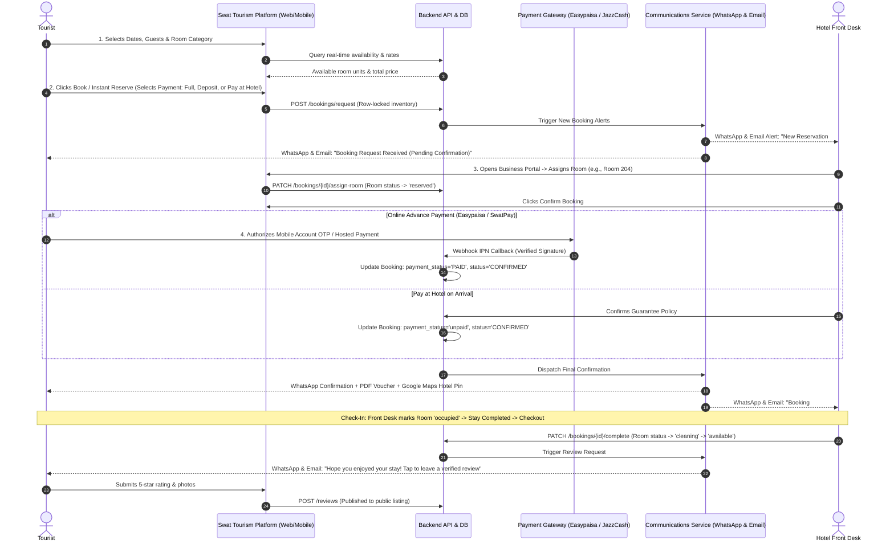

# Swat Tourism Platform: Tourist Booking Flow - Gap Analysis & Implementation Plan

**Document Version:** 1.0.0  
**Generated On:** November 2026  
**Scope:** End-to-End Hotel & Tourism Services Booking Lifecycle

---

## Executive Summary

This document provides a thorough audit and systematic roadmap for the **Tourist Booking Flow** in the Swat Tourism Platform. It evaluates the entire lifecycle from initial availability search, reservation request, hotel manager acceptance, room assignment, multi-channel confirmation (In-Platform, WhatsApp, Email), payment settlement (Easypaisa, JazzCash, SwatPay), check-in/check-out room status transitions, to post-stay verified reviews.

---

## 1. Current State vs. Target State Gap Analysis

| Stage / Component | Current Implementation | Identified Gaps & Deficiencies | Target Production Standard | Priority |
| :--- | :--- | :--- | :--- | :--- |
| **1. Check Availability** | `AvailabilityModal.tsx` fetches generic 30-day availability by `PriceItem` ID from `Availability` table. | • Rate tier availability is disconnected from physical rooms. • Date selection does not intuitively support multi-night check-in/check-out range calculations. | Real-time multi-night availability dynamically bound to physical room status with live price overrides. | **P1 (High)** |
| **2. Booking Request** | `POST /api/v1/bookings/request` saves booking with status `requested` and pessimistic row lock. | • Guest reservations fallback to `localStorage` (`swat_local_bookings`) without automatic background reconciliation. • No structured room preference flags (e.g., floor, bed layout). | Unified booking model supporting instant guest-to-account link, room preferences, and multi-service bundling. | **P2 (Medium)** |
| **3. Platform Confirmation** | Hotel manager clicks Accept in `BusinessShell.tsx`; in-app notification sent to tourist. | • No real-time front desk audio/visual push badge when a new booking arrives. • Printable/downloadable official KP Tourism voucher pass is missing. | Immediate browser push alert for hotel reception + 1-click printable/PDF official booking voucher. | **P2 (Medium)** |
| **4. WhatsApp Notifications** | Phone numbers captured in booking and hotel records; only manual `wa.me` chat links exist. | 🔴 **Major Gap**: No automated WhatsApp dispatch service. • Tourist does not receive automated WhatsApp voucher. • Hotel front desk does not receive instant WhatsApp alert with 1-tap accept button. | Automated WhatsApp Business / Cloud API webhook service dispatching interactive cards to both Tourist and Hotel. | **P0 (Critical)** |
| **5. Email Notifications** | Email captured in auth/guest checkout. Basic HTML invoice generation exists in code. | 🔴 **Major Gap**: No active SMTP / Transactional Email pipeline (SendGrid/SES). • Neither Tourist nor Hotel receives email confirmations or PDF attachments. | Transactional email engine with branded HTML templates and attached PDF vouchers dispatched at booking milestones. | **P0 (Critical)** |
| **6. Physical Room Status** | `AssignRoomModal.tsx` and `physicalRooms.ts` manage room assignment. | 🔴 **Major Gap**: Rooms and assignments are stored exclusively in **browser `localStorage`** (`swat_hotel_physical_rooms`), not in PostgreSQL! • Room status changes (`available` ➔ `reserved` ➔ `occupied` ➔ `cleaning`) do not persist across devices or staff. | Dedicated `hotel_rooms` database table with foreign key relationships, live occupancy history, and automated turnover tracking. | **P0 (Critical)** |
| **7. Payment Completion** | Easypaisa (Hosted & Direct) and JazzCash adapters implemented in backend. Sets `payment_status="PAID"`. | • Partial deposit workflow (e.g. 20% online advance + 80% at hotel arrival) is uncoordinated. • Payment IPN callback does not trigger outbound notification queue. | Unified checkout modal supporting Full Online, Advance Deposit Guarantee, and Pay-at-Hotel, with auto-dispatch trigger on IPN success. | **P1 (High)** |
| **8. Completion & Reviews** | `ReviewModal.tsx` creates verified reviews linked to `booking_id`. | • No automated checkout trigger (WhatsApp & Email prompt: *"Rate your stay at Swat Serena"*). • Hotel responses to reviews not showcased prominently on public detail modals. | Automatic post-checkout notification cascade with 1-tap review submission and public hotel management replies. | **P2 (Medium)** |

---

## 2. End-to-End Target Workflow Architecture

---

## 3. Phased Implementation Plan

### Phase 1: Database Migration for Physical Rooms & Inventory Persistence
* **Goal**: Replace `localStorage` with a robust relational database model.
* **Deliverables**:
  1. `hotel_rooms` Table:
     - `id` (UUID PK)
     - `listing_id` (FK to `listings.id`)
     - `price_item_id` (FK to `price_items.id`)
     - `room_number` (String, e.g. "101", "204B")
     - `floor` (Integer/String)
     - `wing` (Optional string, e.g. "Garden Wing")
     - `category_name` (String, e.g. "Executive Deluxe")
     - `bed_setup` (String, e.g. "1 King Bed", "2 Twin Beds")
     - `status` (Enum: `available`, `reserved`, `occupied`, `cleaning`, `maintenance`)
     - `current_booking_id` (Nullable FK to `bookings.id`)
  2. Backend REST Endpoints:
     - `GET /api/v1/business/listings/{listing_id}/rooms`: List all rooms with active occupancy.
     - `POST /api/v1/business/listings/{listing_id}/rooms`: Create or bulk-seed rooms.
     - `PATCH /api/v1/business/rooms/{room_id}/status`: Change room status (e.g. cleaning to available).
     - `POST /api/v1/bookings/{booking_id}/assign-room`: Assign physical room to booking, auto-transitioning room to `reserved`.
  3. Frontend Migration:
     - Refactor `AssignRoomModal.tsx` and `physicalRooms.ts` to consume live backend APIs with caching fallback.

---

### Phase 2: WhatsApp & Transactional Email Communications Gateway
* **Goal**: Implement multi-channel automated messaging for both Tourist and Hotel.
* **Deliverables**:
  1. Backend Communications Module (`backend/app/modules/communications/`):
     - `whatsapp_service.py`: WhatsApp Business API / Twilio driver with mock/sandbox logger for local development.
     - `email_service.py`: SMTP / SendGrid / SES client with HTML template renderer.
  2. Notification Templates:
     - **Template A (New Request to Hotel)**: WhatsApp + Email to Hotel Manager with Guest Name, Dates, Room Type, and Quick Confirm URL.
     - **Template B (Request Receipt to Tourist)**: WhatsApp + Email to Tourist acknowledging reservation request.
     - **Template C (Booking Confirmed Voucher)**: WhatsApp + Email to Tourist containing Official Booking Reference, Dates, Room Number, GPS Location, and Support Helpline (`0946-9240400`).
     - **Template D (Payment Receipt)**: Transaction ID, Paid Amount, and remaining balance.
     - **Template E (Review Invitation)**: Post-checkout WhatsApp message with direct rating link.
  3. Dispatch Event Hooks:
     - Triggered automatically on `create_booking()`, `accept_booking()`, `process_payment()`, and `complete_booking()`.

---

### Phase 3: Interactive Availability & Multi-Night Date Picker
* **Goal**: Deliver a smooth, modern date-selection and rate-calculation UX for tourists.
* **Deliverables**:
  1. Interactive Date Range Picker in `AvailabilityModal.tsx`:
     - Range selection: Check-in date to Check-out date.
     - Dynamic multi-night stay calculation with price breakdowns.
     - Real-time display of remaining available rooms per category.
  2. Room Preference Selector:
     - Early check-in / late check-out requests.
     - Extra bedding, smoking/non-smoking, or high floor preferences.

---

### Phase 4: Unified Payment & Guarantee Flow
* **Goal**: Seamless handling of Full Payment, Partial Online Deposit, and Pay-at-Hotel.
* **Deliverables**:
  1. Three Flexible Payment Options:
     - **Option 1**: Full Online Payment via Easypaisa / JazzCash / Card.
     - **Option 2**: 20% Advance Online Guarantee Deposit (secures high-season rooms).
     - **Option 3**: Pay at Hotel on Arrival (Credit Card / Cash Guarantee).
  2. Payment IPN Webhook Automation:
     - Automatically updates booking status to `CONFIRMED` and `PAID` / `DEPOSIT_PAID`.
     - Automatically fires Phase 2 WhatsApp & Email confirmation cascade.

---

### Phase 5: Front-Desk Operations, Turnover & Verified Review Loop
* **Goal**: Complete the operational stay lifecycle and tourist feedback loop.
* **Deliverables**:
  1. Front-Desk Reception Quick Actions in `BusinessShell.tsx`:
     - **Check-In Button**: Marks room as `occupied`.
     - **Check-Out Button**: Marks booking as `completed`, changes room status to `cleaning`.
     - **Housekeeping Ready Button**: Reverts room from `cleaning` to `available`.
  2. Post-Stay Verified Review Trigger:
     - Automated WhatsApp & Email prompt sent 2 hours after checkout.
     - `ReviewModal.tsx` pre-filled with verified booking badge.
     - Hotel manager response panel in business dashboard displaying responses on the public listing.

---

## 4. Verification & Testing Strategy

1. **Unit & Integration Tests**:
   - Verify room database schema constraints and foreign key cascades.
   - Verify room status state machine (`available` ➔ `reserved` ➔ `occupied` ➔ `cleaning` ➔ `available`).
   - Mock tests for WhatsApp API and Email SMTP dispatchers.
2. **End-to-End User Journeys**:
   - Tourist searches availability ➔ Books room ➔ Hotel receives WhatsApp alert ➔ Hotel assigns Room 101 and confirms ➔ Tourist receives WhatsApp voucher + Email PDF ➔ Tourist checks in and out ➔ Tourist leaves verified review.

---
*Ready for execution upon user instructions for each phase.*
