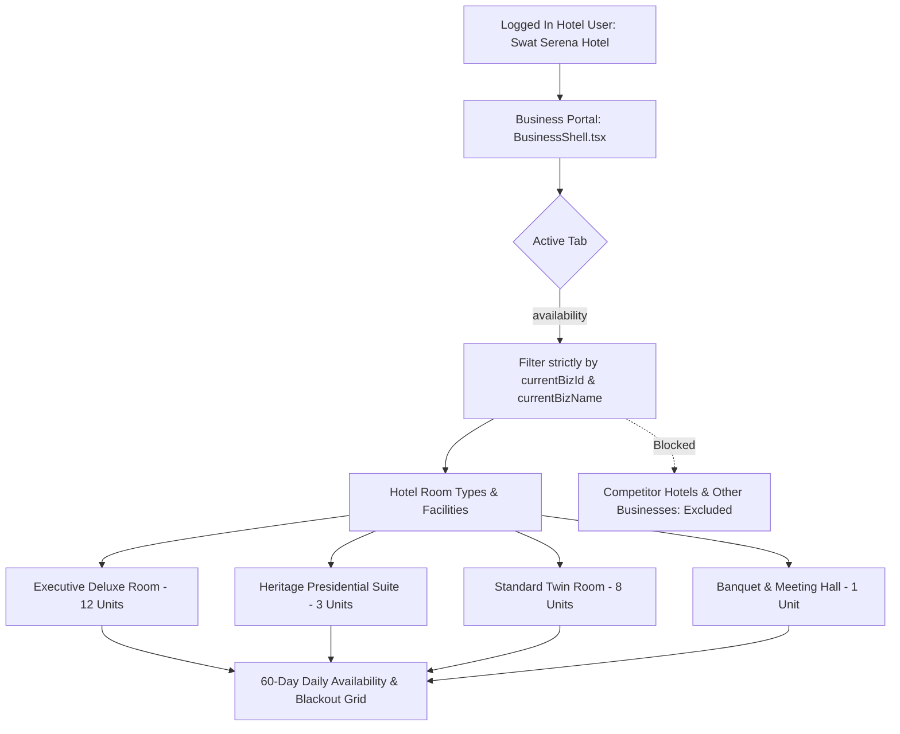

# Implementation Prompt: Scoping Business Portal Availability Tab to Hotel's Own Rooms & Facilities

## 1. Objective & Problem Statement

### 1.1 Current Issue
- On the **Business Portal**, when a hotel manager or business owner logs in (e.g. **Swat Serena Hotel** via `hotel@swat.pk`), the **Availability** tab (`activeTab === 'availability'`) currently displays generic listing cards via `listings.map(...)` where users must click an "Open 60-Day Calendar" modal.
- If un-scoped platform listings are present in state or memory, other businesses or irrelevant non-hotel listings could leak into the view.
- A hotel manager or business owner expects the **Availability Tab** to immediately display **their own hotel's rooms and inventory** (e.g. *Executive Deluxe Room*, *Heritage Presidential Suite*, *Standard Twin Room*, plus banquet/meeting facilities):
  - Unit counts per room type (e.g., 12 Deluxe rooms, 3 Presidential suites, 8 Standard rooms).
  - Real-time 60-day calendar grid with daily available vs. booked units.
  - Quick 1-click date blackout toggles (e.g., maintenance, VIP private bookings).
  - Bulk date range updates and seasonal peak price overrides.
  - **Zero leakage of other businesses or competitor properties.**

### 1.2 Target Deliverables
1. **Strict Business Entity Scoping**:
   - Ensure the Availability tab strictly isolates data using `user.business_profile.id` and `user.business_profile.business_name` (e.g. Swat Serena Hotel, `biz-hotel-1`).
   - If multiple listings exist on the backend, filter strictly by `listing.business_id === currentBizId` or matching property title.
   - If no custom backend listing is found, automatically load the default scoped hotel profile (`Swat Serena Hotel`) with its configured room inventory.

2. **Dedicated Hotel Room & Facility Availability Workspace**:
   - Replace the generic listing card grid with a dedicated **Hotel Availability & Inventory Workspace**:
     - **Property Header**: Shows Hotel Name (`Swat Serena Hotel`), Category (`Luxury Heritage Hotel & Resort`), Total Room Inventory (e.g., `23 Active Rooms`), and Current Occupancy indicator.
     - **Room Selector & Overview Pills**:
       - 🛏️ **Executive Deluxe Room** (12 Units • PKR 18,500/night)
       - 👑 **Heritage Presidential Suite** (3 Units • PKR 42,000/night)
       - 🛏️ **Standard Twin Room** (8 Units • PKR 12,000/night)
       - 🏛️ **Conference & Banquet Hall** (1 Facility • PKR 65,000/day)
     - **Direct Interactive 60-Day Grid**:
       - Direct, embedded view or quick-switch interactive calendar for the selected room type.
       - Daily cells showing: Date, Day of Week, Status badge (`Available` in green, `Booked` / `Sold Out` in amber, `Blocked` in dark red), remaining available units (e.g. `10 / 12 free`), and active rate.
       - Inline click-to-block toggle on any individual day.
     - **Bulk Date Range Manager**:
       - Quick date picker: Start Date to End Date.
       - Quick actions: `Block Range (Blackout)`, `Unblock Range`, `Set Available Units`, and `Seasonal Price Override (PKR)`.

---

## 2. Technical Architecture & File Modifications

### File 1: `frontend/src/modules/business/BusinessShell.tsx`
- **Location**: Tab content under `{activeTab === 'availability' && (...)}` (approx. line 1224–1316).
- **Modifications**:
  1. Retrieve the scoped business identity:
     ```ts
     const currentBizId = user?.business_profile?.id || 'biz-hotel-1';
     const currentBizName = user?.business_profile?.business_name || 'Swat Serena Hotel';
     const myHotelListing = listings.find(
       (l) => l.rawListing?.business_id === currentBizId ||
              l.title.toLowerCase().includes(currentBizName.toLowerCase())
     ) || listings[0];
     ```
  2. Guard against cross-business display: Ensure that ONLY rooms and price items belonging to `myHotelListing` are rendered. Never map across platform-wide business entities.
  3. Render the **Hotel Availability Workspace**:
     - Property Hero card with stats: Total Capacity, Today's Booked Rooms, Total Available Units, Blocked Dates.
     - Room Type selector pills: Allows the hotelier to toggle between room categories (Deluxe, Presidential, Twin, Facilities).
     - Inline or modal-integrated 60-day visual availability matrix with date chips, capacity badges, and price overrides.
     - Quick Bulk Manager drawer or toolbar for fast blackout dates (e.g., Eid holidays, VIP reservations).

### File 2: `frontend/src/modules/business/AvailabilityModal.tsx`
- **Enhancements**:
  1. Support embedded inline mode (optional `embedded?: boolean`) so the 60-day calendar can be rendered directly inside the Availability tab without requiring an extra modal click.
  2. Ensure price items displayed are strictly the room types configured for this hotel:
     - ID: `p-serena-deluxe` -> Executive Deluxe Room (12 units, Rs 18,500)
     - ID: `p-serena-suite` -> Heritage Presidential Suite (3 units, Rs 42,000)
     - ID: `p-serena-twin` -> Standard Twin Room (8 units, Rs 12,000)
  3. Ensure API calls to `fetchAvailability(listingId, startStr, endStr)` and `setAvailability(listingId, items)` use the authenticated hotel's `listingId`.

---

## 3. Data Flow & Scoping Enforcement



---

## 4. Acceptance Criteria & Validation

1. **Role & Entity Scoping**:
   - When logged in as `hotel@swat.pk` (Swat Serena Hotel), navigating to `http://localhost:5180/?role=business&tab=availability` must ONLY show Swat Serena Hotel's rooms and facilities.
   - No listings or room types from other hotels (e.g. Kalam Alpine Lodge, Riverside Inn) or non-hotel businesses (e.g. Jeeps, Guides, Restaurants) must ever appear in the Availability tab.

2. **Room & Availability Management Capabilities**:
   - Hotel owner/manager can view all their defined room types with their default unit capacities.
   - Hotel owner/manager can view a 60-day calendar showing daily available vs. booked units.
   - Hotel owner/manager can click any date to toggle blackout/blocked status.
   - Hotel owner/manager can apply bulk date range updates for units, rates, or blockouts.

3. **Responsive Design & UX**:
   - Clean, high-contrast, modern UI adhering to design system tokens (`var(--surface)`, `var(--ink)`, `var(--brand)`, `var(--ok)`, `var(--bad)`).
   - High visual clarity with badges for `Available`, `Occupied`, and `Blocked`.
