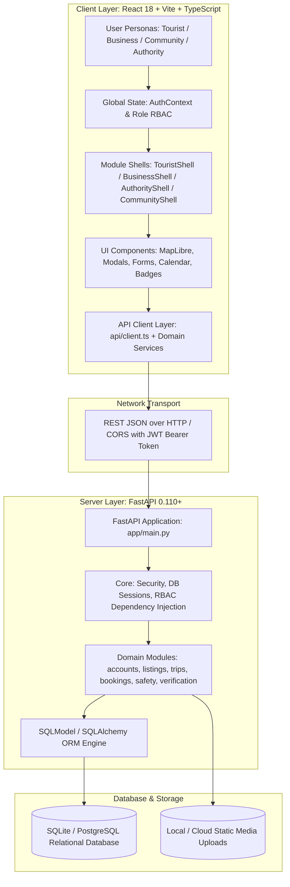
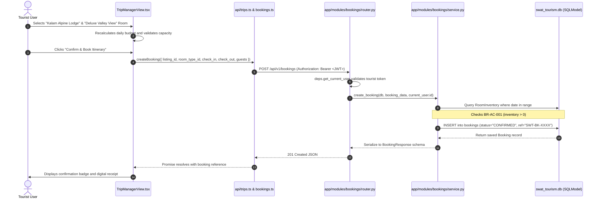
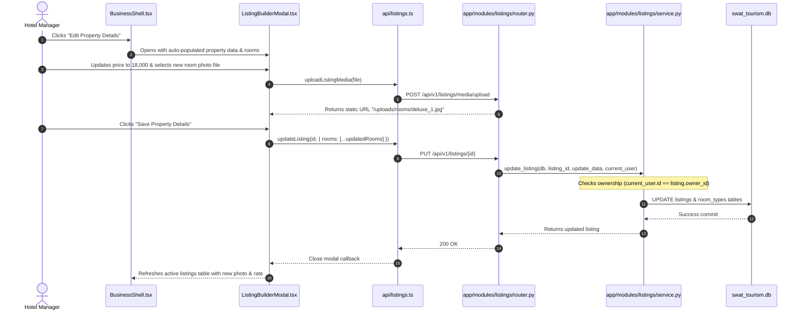
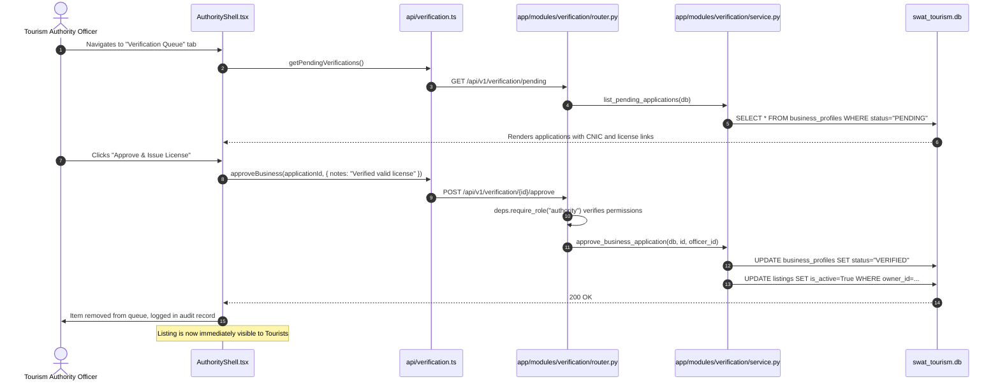
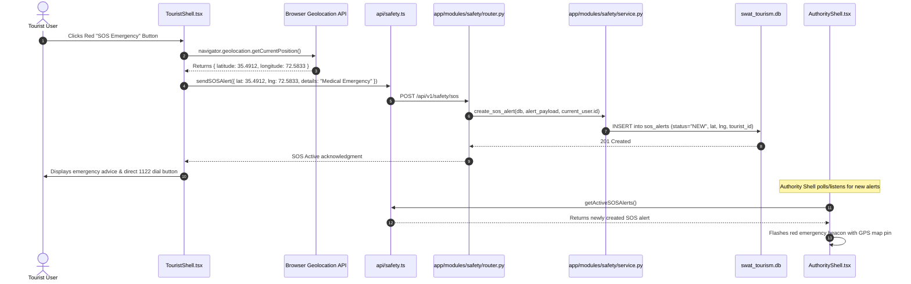

# Swat Tourism Platform — Code Architecture, Structure & Calling Flow Guide

**Audience:** Technical Management, Lead Architects, and Development Team  
**Scope:** Swat Tourism Digital Ecosystem Full-Stack Platform  
**Architecture Pattern:** Domain-Driven Modular Monolith (FastAPI + SQLModel Backend) & Feature-Sliced Single Page Application (React + Vite + TypeScript Frontend)  

---

## 1. High-Level System Architecture



---

## 2. Directory Structure Breakdown

### 2.1 Backend Structure (`/backend`)
The backend uses a **Domain-Driven Design (DDD) Modular Architecture**. Instead of separating controllers, services, and models into monolithic folders, each business capability is an isolated, self-contained module.

```text
backend/
├── app/
│   ├── core/                      # Global Foundation Layer
│   │   ├── config.py              # Pydantic Settings (ENV variables, CORS, secrets)
│   │   ├── database.py            # Engine initialization, SessionLocal, Base model
│   │   ├── deps.py                # FastAPI Dependency Injection (get_db, get_current_user, require_role)
│   │   └── security.py            # Password hashing (Argon2/Bcrypt) & JWT token handling
│   │
│   ├── modules/                   # Self-Contained Business Domains
│   │   ├── accounts/              # User registration, authentication, profiles, RBAC roles
│   │   ├── listings/              # Hotels, rooms, transport, guides, activities, restaurants
│   │   ├── trips/                 # Itinerary builder, distance calculations, day-to-day plan
│   │   ├── bookings/              # Reservations, availability checks, payments, cancellations
│   │   ├── safety/                # Emergency SOS alerts, 1122 contacts, road & weather advisories
│   │   ├── verification/          # Business document quality gate (Approve / Reject)
│   │   ├── community/             # Local artisan listings, cultural stories, host applications
│   │   ├── reviews/               # 5-star ratings, tourist reviews, provider reply threads
│   │   ├── content/               # Swat destinations, historical sites, attractions
│   │   └── notifications/         # Notification events, in-app alerts
│   │
│   └── main.py                    # Root FastAPI app, router aggregation, CORS, lifespan handler
│
├── alembic/                       # Database schema migrations
├── swat_tourism.db                # SQLite database instance
├── requirements.txt               # Backend dependencies (fastapi, uvicorn, sqlmodel, pydantic)
└── Dockerfile                     # Containerization definition
```

#### Inside Every Module (`backend/app/modules/<module_name>/`)
Each module follows a strict 4-tier pattern:
1. `models.py`: Defines the database table schema using **SQLModel** (e.g. `Listing`, `Booking`, `RoomType`).
2. `schemas.py`: Defines **Pydantic** schemas for request validation (`CreateRequest`, `UpdateRequest`, `Response`).
3. `service.py`: Contains the pure business logic, calculations, and database query executions.
4. `router.py`: Exposes HTTP REST endpoints, validates inputs, and delegates to `service.py`.

---

### 2.2 Frontend Structure (`/frontend/src`)
The frontend is built with **Vite + React 18 + TypeScript**, styled with custom design tokens (no bulky third-party CSS frameworks), ensuring blazing speed and responsive rendering.

```text
frontend/src/
├── api/                           # API Communication Layer
│   ├── client.ts                  # Axios/Fetch HTTP wrapper with JWT interceptor & base URL
│   ├── listings.ts                # API calls for stays, rooms, vehicles, guides, activities
│   ├── trips.ts                   # API calls for trip creation, itinerary generation, stops
│   ├── bookings.ts                # API calls for reservations, payment checkout, cancellations
│   ├── safety.ts                  # API calls for SOS broadcast, weather & road condition advisories
│   ├── verification.ts            # API calls for business verification queue & approval actions
│   ├── reviews.ts                 # API calls for reviews submission and provider replies
│   └── community.ts               # API calls for local crafts and host submissions
│
├── context/                       # Global React Contexts
│   ├── AuthContext.tsx            # Current user session, role claims, login/logout, tokens
│   └── ThemeContext.tsx           # Dark/Light mode theme state
│
├── layouts/                       # Layout & Navigation Scaffolding
│   ├── RoleLayout.tsx             # Master viewport frame (Navbar, Sidebar, Footer, Role pill)
│   └── navItems.ts                # Role-specific navigation items (Tourist, Business, Authority, Community)
│
├── modules/                       # Role-Specific Feature Shells
│   ├── tourist/
│   │   ├── TouristShell.tsx       # Master tourist experience (Explore, Stays, Guides, Bookings)
│   │   └── TripManagerView.tsx    # Interactive itinerary generator & hotel room selection
│   ├── business/
│   │   ├── BusinessShell.tsx      # Business dashboard, revenue KPIs, incoming bookings
│   │   ├── ListingBuilderModal.tsx # Multi-room listing editor & individual photo uploader
│   │   ├── BusinessServicesManagerModal.tsx # In-place room & service management
│   │   └── HotelAvailabilityCalendarModal.tsx # Visual 60-day availability & blackout calendar
│   ├── authority/
│   │   └── AuthorityShell.tsx     # Government desk (Verification queue, SOS board, Advisories)
│   └── community/
│   │   └── CommunityShell.tsx     # Local artisans, homestay hosts, cultural story listings
│   │
├── components/                    # Reusable Design System UI Elements
│   ├── Map.tsx                    # MapLibre GL map engine with markers for Swat landmarks
│   ├── Modal.tsx                  # Accessible dialog overlay with focus management
│   ├── AlertBanner.tsx            # High-priority road blockage and weather advisory banner
│   └── Badge.tsx / Button.tsx     # Standardized atomic design elements
│
├── App.tsx                        # Master application routing & role switcher
└── main.tsx                       # React DOM entry point
```

---

## 3. End-to-End Code Calling Flow (The Request Lifecycle)

Every interaction follows a standardized, predictable **7-step round trip**:

```text
[1. User Action in UI]
       │
       ▼
[2. React Component Handler] (e.g. handleConfirmBooking in TouristShell.tsx)
       │
       ▼
[3. Frontend API Client] (api/bookings.ts -> client.ts with Bearer Token)
       │
       ▼  (HTTP POST /api/v1/bookings/)
[4. FastAPI Route Router] (app/modules/bookings/router.py)
       │   ├── Input validation via Pydantic Schema (BookingCreate)
       │   └── Dependency Injection (db: Session, current_user: User)
       ▼
[5. Module Service Layer] (app/modules/bookings/service.py)
       │   ├── Checks room inventory & availability calendar
       │   ├── Computes total price (nights × rate)
       │   └── Executes DB transaction via SQLModel
       ▼
[6. Database Persistence] (SQLite / PostgreSQL swat_tourism.db)
       │
       ▼  (HTTP 200/201 JSON Response)
[7. React State Update & Re-render]
       ├── Sets local state (e.g. setConfirmedBooking(res.data))
       ├── Displays instant feedback (Toast notification / Receipt modal)
       └── Refreshes bookings list
```

---

## 4. Deep-Dive Calling Flows for Critical Real-World Scenarios

### Scenario A: Tourist Selects a Room and Books in Itinerary
*Goal: Tourist plans a 3-day Kalam trip, picks Kalam Alpine Lodge, selects "Deluxe Valley View" room, and books it.*



---

### Scenario B: Business Manager Updates Room Inventory & Photo
*Goal: Hotel manager opens Business Portal, modifies the Deluxe Room rate to 18,000 PKR, uploads a new room photo, and saves.*



---

### Scenario C: Authority Officer Verifies a Business License
*Goal: Tourism officer reviews pending hotel registration and approves it, making it live for tourists.*



---

### Scenario D: Emergency SOS Alert Broadcast & Dispatch
*Goal: Tourist in Kalam encounters an emergency, presses SOS; Authority receives alert instantly.*



---

## 5. Key Engineering Strengths & Architectural Highlights

1. **Strict Separation of Concerns**:
   - The frontend never makes direct database or backend assumptions. All data passes through strictly typed TypeScript interfaces (`api/*.ts`).
   - The backend adheres to thin routers, rich services, and clean declarative ORM models.
2. **Unified SQLModel Architecture**:
   - Eliminates boilerplate by combining **Pydantic schemas** and **SQLAlchemy tables** into single Python definitions, preventing model drift between serialization and database tables.
3. **Role-Based Access Control (RBAC) at Every Level**:
   - **Frontend**: Navigation and view shells are guarded by the user's active session role (`tourist`, `business`, `authority`, `community`, `super_admin`).
   - **Backend**: Every sensitive route uses FastAPI dependencies (`Depends(require_role("..."))`) preventing privilege escalation.
4. **Data Integrity & Business Rule Enforcement**:
   - Inventory availability is guarded at the database level before any booking confirmation is generated (**BR-AC-001**).
   - Only approved and verified businesses can have listings visible in the public tourist marketplace (**BR-002**).
5. **Resilient Local Media & Geospatial Support**:
   - Built-in static upload pipeline (`/uploads`) serves images locally without external cloud dependencies during prototypes.
   - MapLibre GL powers fast, responsive, vector-rendered mapping with accurate coordinates across Swat District.

---

## 6. Executive Talking Points (Boss Demo Summary)

When giving the demonstration to your boss or leadership team, highlight these **5 core points**:

1. **"The codebase is not a prototype toy—it is structured like an enterprise product."**
   - We organized the backend into Domain-Driven Modules (`listings`, `bookings`, `safety`, `verification`), matching the exact structure used by modern high-scale travel platforms.
2. **"Complete multi-persona coverage from day one."**
   - The same single codebase powers all four stakeholders: the Tourist, the Hotel/Service Provider, the Local Community Artisan, and the Government Tourism Authority.
3. **"100% Traceable Code Calling Flow."**
   - Every click in the user interface flows through an unambiguous pipeline: Component $\rightarrow$ Typed API Service $\rightarrow$ FastAPI Router $\rightarrow$ Dependency Guard $\rightarrow$ Service Logic $\rightarrow$ Database Transaction $\rightarrow$ UI State.
4. **"Strict quality and safety gates are built into the code."**
   - No business can publish unverified listings, no tourist can overbook a room with zero inventory, and emergency SOS alerts immediately route to the government dispatch board with live GPS coordinates.
5. **"Seamless path to commercial scale."**
   - The architecture is decoupled. Switching from mock payments to real JazzCash, or attaching an SMS gateway, requires editing just a single service file without touching the UI or database structure.
