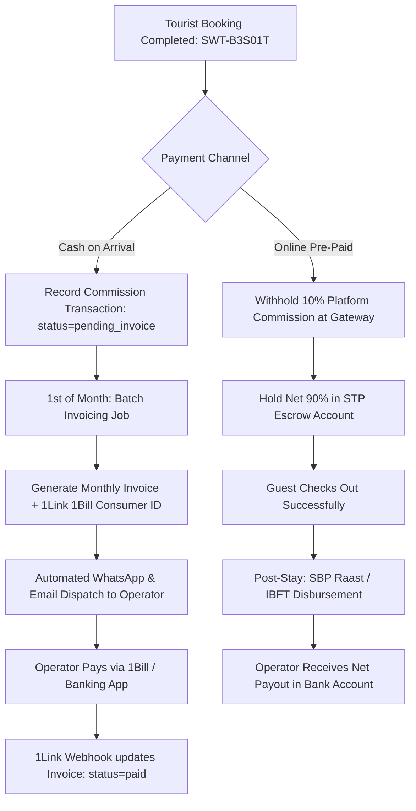

# Implementation Prompt: Commission, Billing Invoices & Owner Financial Control Engine

**Project:** Swat Tourism Platform (STP) Production v2.0  
**Target Solution:** Dynamic Commission Governance, Monthly Invoicing (1Link 1Bill & JazzCash), SBP Raast Operator Payouts & Authority Financial Command Center  
**Associated Architecture Docs:**
- [swat-tourism-commission-billing-and-payouts-architecture.docx](file:///f:/Antigravity/SwatTourismProduction_v2/Docs/swat-tourism-commission-billing-and-payouts-architecture.docx)
- [swat-tourism-platform-payments-and-invoices-workflow.docx](file:///f:/Antigravity/SwatTourismProduction_v2/Docs/swat-tourism-platform-payments-and-invoices-workflow.docx)  
**Date:** November 2026 | Production Implementation Prompt  

---

## 1. Objective & Scope

Implement the complete **Commission, Billing, and Operator Invoicing System** benchmarked against **Booking.com's dual model** and adapted for Pakistan's national banking rails:

1. **Dual Billing Rails Engine**:
   - **Cash on Arrival (Agency Model)**: Automated monthly invoice generation on the 1st of each month with 1Link 1Bill Consumer Number, JazzCash/Easypaisa QR code, and bank IBFT details for completed stays.
   - **Online Pre-Paid (Merchant Model)**: Automatic 10% platform commission withholding at checkout, holding net 90% in master escrow during the stay, and automated disbursement post-checkout via SBP Raast / IBFT.
   - **Automated Balance Net-Offsetting**: Auto-offsets cash debts against online payouts to minimize bank wire transfers.

2. **Differentiated Commission Tier System**:
   - `Hotels & Resorts`: **10% – 12%** (customizable per partner e.g. 7.5% for Serena).
   - `Transport & 4x4 Mountain Jeeps`: **5% – 7%** (low margin protection for rough routes).
   - `Tour Guides & Porters`: **8% – 10%** (direct local youth empowerment).
   - `Restaurants & Cafes`: **5%** (table reservations and pre-ordered meal bundles).

3. **Platform Owner / Super Admin Financial Command Center (`AuthorityShell.tsx`)**:
   - **Rate Sliders & Partner Overrides**: Manage base vertical rates and custom negotiated contracts.
   - **Payout Approval & Escrow Queue**: Maker-checker OTP authorization for disbursements > PKR 50,000; 1-click "Freeze Payout" button for disputed trips.
   - **Graduated Delinquency Enforcement ("Kill Switch")**: Automated escalation sequence for unpaid cash invoices (Day 10 Reminder -> Day 20 Demotion -> Day 25 Instant Booking Lock).
   - **Fraud & No-Show Arbitration**: Console to arbitrate hotel no-show claims vs tourist GPS/WhatsApp check-in signals.

4. **Operator Portal Experience (`BusinessShell.tsx`)**:
   - **"Earnings & Invoices" Tab**: For hotels, drivers, guides, and restaurants.
   - View gross booking GMV, direct cash collected, online escrow balances, and net commission payable.
   - Interactive **"Pay Invoice"** modal with 1Bill Consumer ID and dynamic JazzCash QR.
   - 48-Hour **"Report No-Show"** button to waive commission on legitimate cancellations.

---

## 2. Technical Architecture & Component Touchpoints

---

## 3. Implementation Plan & Target Files

### Phase 1: Database Models & Schemas
* **`backend/app/modules/finance/models.py`** *(New Module)*:
  * `CommissionTier` (vertical, default_rate, min_fee, is_active)
  * `PartnerCommissionOverride` (business_id, custom_rate, valid_until, reason)
  * `CommissionTransaction` (booking_id, business_id, gross_amount, commission_rate, commission_amount, settlement_channel, status)
  * `MonthlyInvoice` (invoice_number, business_id, month, year, total_commission, onebill_id, status, due_date)
  * `OperatorPayout` (payout_ref, business_id, amount, channel, raast_id, status)
* **`backend/app/modules/finance/schemas.py`** *(Pydantic Schemas)*

### Phase 2: Backend Financial Engine & API Endpoints
* **`backend/app/modules/finance/routes.py`**:
  * `GET /api/finance/commission-settings` (Admin: view all rates)
  * `PUT /api/finance/commission-settings` (Admin: update rates/overrides)
  * `GET /api/finance/invoices/my-invoices` (Operator: view history & bills)
  * `POST /api/finance/invoices/generate-monthly` (Admin/Cron: trigger billing batch)
  * `POST /api/finance/invoices/{id}/pay` (Mock 1Bill / JazzCash payment confirmation)
  * `POST /api/finance/payouts/approve` (Admin: Maker-checker release)
  * `POST /api/finance/payouts/{id}/freeze` (Admin: freeze disputed escrow)
  * `POST /api/finance/no-show-dispute` (Operator: report no-show)

### Phase 3: Frontend Operator & Authority Modules
* **`frontend/src/modules/business/OperatorEarningsInvoicesView.tsx`** *(New View for Hotels, Drivers, Guides)*:
  * Financial metrics cards (Gross Booked, Cash Received, Commission Due, STP Escrow Credit).
  * Invoices table with status badges (`PAID`, `DUE`, `OVERDUE`).
  * "Pay via 1Bill / JazzCash" modal.
* **`frontend/src/modules/authority/OwnerFinancialControlCenter.tsx`** *(New View in Authority Portal)*:
  * Real-time Gross Merchandise Value (GMV), platform revenue, and pending escrow metrics.
  * Commission slider configuration panel.
  * Payout approval queue with OTP authorization.
  * Delinquent accounts table with "Send WhatsApp Alert" and "Instant Reserve Lock" toggles.

### Phase 4: Automated Testing & Validation
* **`backend/tests/test_finance_commission.py`**:
  * Test commission calculation for hotels (10%) and jeeps (5%).
  * Test monthly invoice aggregation and 1Bill consumer ID generation.
  * Test automated balance offsetting (cash debt vs online credit).
  * Test no-show commission waiver flow.
* **`frontend/src/test/operator_invoices_and_payouts.test.tsx`**:
  * Verify operator invoice list rendering and pay modal.
  * Verify authority rate sliders and freeze payout toggles.

---

## 4. Verification & Acceptance Criteria

1. **Accuracy**: Commission calculations mathematically match vertical tiers (e.g. PKR 25,000 stay @ 10% = PKR 2,500 commission).
2. **Dual-Model Parity**: Cash bookings correctly queue into monthly invoices; online bookings correctly deduct at source and trigger post-stay payouts.
3. **Owner Command**: The platform owner can change rates, freeze suspicious payouts, and block delinquent partners.
4. **UI Excellence**: Follows the emerald/teal design system with clear status badges, mobile responsiveness, and 1-click WhatsApp payment sharing.
