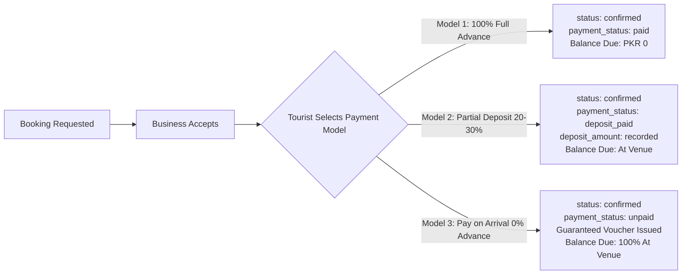

# Payment, Hotel Stay & Trip Completion: Architectural Gap Analysis & Implementation Plan

**Platform:** Swat Tourism Platform (STP) Production v2.0  
**Domains Covered:** Advance Payment Models (Full/Partial Deposit), Tourist Checkout, Hotel Stay Management, Trip Lifecycle Completion  
**Target Solution:** Unified SwatPay Multi-Provider Checkout & Front-Desk Stay Lifecycle  
**MS Word Document:** [swat-tourism-payment-hotel-trip-completion-gap-analysis.docx](file:///f:/Antigravity/SwatTourismProduction_v2/Docs/swat-tourism-payment-hotel-trip-completion-gap-analysis.docx)  
**Date:** October 2026 | Production Readiness Assessment (Updated)  

---

## 1. Executive Summary & Problem Statement

The Swat Tourism Platform (STP) has implemented rich discovery, trip planning, transport fleet management, and physical room rack allocation. However, bridging the platform into a production commercial travel solution requires closing architectural gaps across three core workflows:
1. **Multi-Channel Digital Payments & Flexible Advance Options**: Bypassing simulated payment callbacks on entire trips and introducing a multi-provider checkout modal supporting Full Payment (100%), Partial Advance Deposits (20–30%), and Pay-on-Arrival across Easypaisa, JazzCash, Cards, and Raast QR.
2. **Hotel Stay Operational Lifecycle**: Moving beyond static room assignment to real-time front-desk actions (Guest Check-In $\rightarrow$ In-House Folio $\rightarrow$ Check-Out & Housekeeping Turnover).
3. **Trip Completion & Feedback**: Introducing automated temporal status progression and verified multi-vendor traveler reviews (Hotel + Transport + Guides).

---

## 2. Payment Architecture & Gap Analysis (Tourist & Business)

### Current Implementation State
* Gateway adapters exist in `backend/app/modules/bookings/payment_adapter.py` supporting HMAC-SHA256 signatures for **Easypaisa** and **JazzCash**.
* IPN callback listeners are active: `POST /api/v1/bookings/easypaisa/ipn-callback` and `POST /api/v1/bookings/jazzcash/ipn-callback`.
* In `TouristShell.tsx`, `handleMockPayment` triggers a simulated toast and updates trip status to `confirmed`.
* In `frontend/src/components/EasypaisaPaymentModal.tsx`, an Easypaisa-only modal exists for individual bookings.

### Identified Gaps & Required Upgrades

| Payment Sub-system | Current Implementation | Identified Gap & Required Upgrade | Severity |
| :--- | :--- | :--- | :--- |
| **Entire Trip Bundle Checkout** (`btn-pay-trip`) | Clicking "Pay & Confirm Trip" executes `handleMockPayment` (toast simulation). | **CRITICAL GAP:** Bypasses payment method selection entirely. No itemized checkout showing hotel rooms, rental cars, and tour guide totals. Needs unified "SwatPay Modal". | Critical |
| **Individual Booking Checkout** (A-la-carte) | `EasypaisaPaymentModal` handles single bookings via mobile number. | **HIGH GAP:** Restricted exclusively to Easypaisa. Tourists cannot select JazzCash, Credit/Debit Cards, Raast, or Pay-on-Arrival. | High |
| **State Bank Raast Instant QR Rail** | Not integrated in UI. | **HIGH GAP:** Dynamic QR payload generation with zero transaction fees is essential for domestic banking users (HBL, Meezan, Alfalah). | High |
| **Pay-on-Arrival / Mountain Continuity** | Digital checkout only. | **HIGH GAP:** Remote mountain valleys (Kalam, Ushu Forest, Mahodand) experience cellular dropouts. Needs reservation guarantee voucher with vendor contact instructions and offline PIN. | High |
| **Escrow & Merchant Settlement Ledger** | Bookings are marked `paid`, but funds sit in platform pool. | **MEDIUM GAP:** No automated split between the 5% Tourism Development Levy and Net Vendor Payout (95%). Hotel dashboard lacks payout disbursement tracker. | Medium |

---

## 3. Advance Payment Policy: Full vs. Partial Deposit vs. Pay-on-Arrival

### Is Advance Payment Required for Booking Confirmation?

**Yes, the Swat Tourism Platform supports three distinct operational payment models** to accommodate seasonal hospitality dynamics and mountain connectivity realities:

### Commercial Comparison Matrix

| Payment Model | Advance Required | Booking Status & Confirmation Rules | Front-Desk Balance Due | Best Suited For |
| :--- | :--- | :--- | :--- | :--- |
| **1. Full Advance Payment** *(100% Upfront)* | 100% of total charged at checkout via Easypaisa, JazzCash, Card, or Raast. | • `status`: `confirmed` • `payment_status`: `paid` • Immediate confirmation upon webhook. | **PKR 0** (Check-in executed with zero financial collection) | Peak summer rush (June–Aug), winter ski season in Malam Jabba, luxury suites, and discounted non-refundable rates. |
| **2. Partial Advance Deposit** *(20%–30% or 1st Night)* | Partial amount charged upfront (e.g. PKR 6,000 on a PKR 24,000 stay). | • `status`: `confirmed` • `payment_status`: `deposit_paid` • `deposit_amount`: saved in database • Room secured on rack. | **PKR 18,000** (Front desk collects remaining balance at check-in or checkout) | Standard hotel reservations, multi-day itineraries, and private transport hire (HiAce/Prado with driver). |
| **3. Pay on Arrival** *(0% Advance Guarantee)* | PKR 0 charged upfront. Reservation held via verified mobile / CNIC or card guarantee. | • `status`: `confirmed` • `payment_status`: `unpaid` • Guaranteed check-in voucher issued. | **100% Total** (Collected at hotel reception) | Remote alpine valleys (Kalam, Ushu, Mahodand) with intermittent internet connectivity and off-peak travel. |

### Business Rules & Needed Implementation:
1. **Dynamic Selector in SwatPay Modal**: The checkout modal must provide an interactive toggle:
   * `[●] Pay Full Amount (PKR 24,000)` — Best Rate Guarantee
   * `[○] Pay 25% Deposit (PKR 6,000 now, PKR 18,000 at Hotel)`
   * `[○] Pay on Arrival (PKR 0 now, PKR 24,000 at Venue)`
2. **Hotel Today Screen Front-Desk View**: When a guest arrives with `payment_status = 'deposit_paid'`, the front-desk card must render:
   $$\text{Balance Due} = \text{Total Amount} - \text{Deposit Amount} + \text{In-Stay Incidentals}$$
   *Example: Total: PKR 24,000 | Deposit Paid: PKR 6,000 | **Balance Due: PKR 18,000**.*
3. **Cancellation & Refund Policy**:
   * Cancellations made $> 48$ hours prior to check-in receive a 100% refund of the deposit.
   * Cancellations made $< 48$ hours prior forfeit the deposit to compensate the hotel for holding the physical room.

---

## 4. Hotel Stay Operational Lifecycle & Front-Desk Controller

### Current Implementation State
* In `HotelTodayScreen.tsx`, hotel managers can view inbound requests, accept/decline bookings, and assign physical room numbers via `AssignRoomModal.tsx` (e.g. Room 204 - Pine Wing).
* Room rack defines statuses: `available`, `reserved`, `occupied`, and `cleaning`.

### Identified Gaps & Required Upgrades

| Lifecycle Stage | Current Implementation | Operational Gap & Required Fix | Severity |
| :--- | :--- | :--- | :--- |
| **1. Guest Arrival & Check-In** | Displays static badge: `Ready for check-in`. | **CRITICAL GAP:** No interactive "Check-In" button. Front desk staff cannot record guest arrival timestamp (`actual_checkin_at`), verify CNIC, or transition room to `occupied`. | Critical |
| **2. Key Assignment & Voucher Sync** | Room assignment is stored in browser `localStorage`. | **HIGH GAP:** Assigned physical room is not synced to backend booking record. Tourist digital voucher in `TripManagerView.tsx` does not reflect room number or WiFi access slip. | High |
| **3. In-House Stay & Folio** | Booking total remains static. | **MEDIUM GAP:** Cannot append room dining, laundry, or extra bed charges to guest stay. Staff have no guest folio summary for checkout settlement. | Medium |
| **4. Check-Out & Settlement** | No check-out action button. | **CRITICAL GAP:** Front desk cannot execute check-out. Booking does not transition to `completed`. Outstanding folio balances cannot be finalized. | Critical |
| **5. Housekeeping Turnover** | Room statuses are updated via manual rack dropdown. | **HIGH GAP:** Check-out does not automatically flip room to `cleaning`. Housekeeping staff receive no notification when a room is vacated and ready for linen change. | High |

---

## 5. Trip Completion Lifecycle & Traveler Feedback Loop

### Current Implementation State
* In `TripManagerView.tsx`, a manual "Complete" button (`btn-complete-trip`) updates `trip.status = 'completed'` and invokes `onCompleteBooking`.
* Tapping complete triggers `ReviewModal` for the first booking item.

### Identified Gaps & Required Upgrades

| Completion Component | Current Implementation | Deficiency & Needed Implementation | Severity |
| :--- | :--- | :--- | :--- |
| **Trip State Automation** | Trips remain in `draft` or `confirmed` indefinitely. | **HIGH GAP:** System should auto-transition trip to `in_progress` when start date is reached, and prompt for completion when end date passes and hotels are checked out. | High |
| **Multi-Entity Feedback Loop** | Rating prompt only covers a single booking. | **CRITICAL GAP:** A typical Swat trip bundles a Hotel, a 4x4 Jeep driver, and a local guide. Travelers need a multi-step review wizard evaluating each service independently. | Critical |
| **Trip Completion Dossier** | Individual booking vouchers are printable. | **HIGH GAP:** Missing downloadable "Swat Journey Summary Dossier" compiling route map, all paid tax receipts, mileage logs, and digital tourism heritage certificate. | High |
| **Reputation & Rating Sync** | Reviews submit rating scores to local mock/API storage. | **MEDIUM GAP:** Completed verified reviews should immediately update hotel `rating_avg` and `rating_count` badges on public exploration cards. | Medium |

---

## 6. Target Solution Architecture & Implementation Plan

### Implementation Milestones & Target Files

| Phase | Milestone Deliverables | Target Files | Verification Metric |
| :--- | :--- | :--- | :--- |
| **Phase 1: Core SwatPay UI** | Develop unified `SwatPayModal.tsx` with Full vs. Partial Deposit selector, 5 payment channels, and 1-click demo auto-fill. | `frontend/src/components/SwatPayModal.tsx` | 100% responsive across mobile (430px) and desktop |
| **Phase 2: Checkout Integration** | Wire `btn-pay-trip` in `TripManagerView.tsx` and `TouristShell.tsx` to launch SwatPayModal. | `TripManagerView.tsx` `TouristShell.tsx` | All 119 vitest tests continue to pass without regression |
| **Phase 3: Hotel Front-Desk Workflow** | Add interactive "Check-In", "Check-Out", and deposit balance due tracking on `HotelTodayScreen.tsx`. | `HotelTodayScreen.tsx` `physicalRooms.ts` | Room rack status and balance due update dynamically |
| **Phase 4: Room & Voucher Sync** | Sync assigned physical room number to backend booking record and display on tourist vouchers. | `AssignRoomModal.tsx` `TripManagerView.tsx` | Vouchers display assigned room number & check-in QR |
| **Phase 5: Multi-Review & Trip Dossier** | Implement multi-vendor review loop and consolidated Journey Summary Dossier with PDF print formatting. | `ReviewModal.tsx` `TripManagerView.tsx` | Verified ratings update listing badges immediately |
