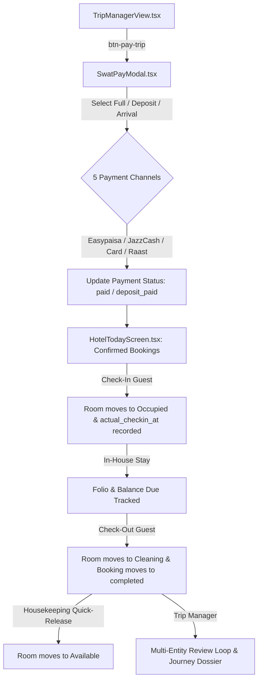

# Implementation Prompt: Payment, Hotel Stay Operations & Trip Completion

**Project:** Swat Tourism Platform (STP) Production v2.0  
**Target Solution:** Unified SwatPay Multi-Provider Checkout, Front-Desk Hotel Stay Lifecycle & Trip Completion Engine  
**Associated Gap Analysis:** [swat-tourism-payment-hotel-trip-completion-gap-analysis.docx](file:///f:/Antigravity/SwatTourismProduction_v2/Docs/swat-tourism-payment-hotel-trip-completion-gap-analysis.docx)  
**Date:** October 2026 | Production Implementation  

---

## Objective & Scope

Implement the architectural gap analysis across three interconnected domains to transform the Swat Tourism Platform into an end-to-end commercial travel engine:
1. **Unified SwatPay Multi-Provider Checkout (`SwatPayModal.tsx`)**:
   - Support both **Entire Trip Bundle** (`btn-pay-trip`) and **Single A-la-carte Bookings**.
   - Flexible **Advance Payment Selector**:
     - `100% Full Advance` (locks in rate, balance due = PKR 0).
     - `25% Partial Advance Deposit` (charges deposit, records `deposit_amount`, balance due at hotel).
     - `Pay on Arrival` (0% upfront, reservation guarantee voucher with offline valley PIN).
   - 5 Payment Channels: **Easypaisa**, **JazzCash**, **Credit/Debit Cards (Visa/Mastercard)**, **SBP Raast Dynamic QR Code**, and **Pay on Arrival Guarantee**.
   - 1-Click **Demo Sandbox Credentials Auto-Fill** for frictionless demonstrations and test automation.
2. **Hotel Stay Operational Lifecycle (`HotelTodayScreen.tsx` & `physicalRooms.ts`)**:
   - Interactive **"Check-In Guest"** button on confirmed bookings:
     - Prompts and timestamps `actual_checkin_at`.
     - Transitions assigned physical room status from `reserved` to `occupied`.
     - Displays guest digital key slip and WiFi voucher.
   - **Deposit Balance Due Ledger**:
     - When `payment_status === 'deposit_paid'`, renders: `Deposit Paid: PKR X | Balance Due: PKR Y`.
     - Allows front-desk staff to mark balance collected.
   - Interactive **"Check-Out Guest"** button:
     - Finalizes folio.
     - Transitions room status from `occupied` to `cleaning`.
     - Marks booking status as `completed`.
   - Housekeeping Turnover: 1-click **"Mark Cleaned"** on cleaning rooms to return to `available`.
   - **Physical Room Sync**: Assigned physical room numbers reflect directly on tourist vouchers in `TripManagerView.tsx`.
3. **Trip Completion & Multi-Entity Reviews (`TripManagerView.tsx`)**:
   - `btn-complete-trip` terminates stay, updates `trip.status = 'completed'`, and triggers the post-stay review wizard.
   - Display verified badge and print/share options.

---

## Technical Specifications & Touchpoints

### Key Target Files:
1. `frontend/src/components/SwatPayModal.tsx` *(New Core Component)*
2. `frontend/src/modules/tourist/TouristShell.tsx` *(Wiring SwatPay modal for single and trip payments)*
3. `frontend/src/modules/tourist/TripManagerView.tsx` *(Wiring `btn-pay-trip`, voucher room sync, completion)*
4. `frontend/src/modules/business/HotelTodayScreen.tsx` *(Check-in, Check-out, Deposit balance display, Room turnover)*
5. `frontend/src/modules/business/physicalRooms.ts` *(Room assignment sync and housekeeping status helpers)*
6. `frontend/src/modules/business/AssignRoomModal.tsx` *(Sync assigned room to booking record)*

---

## Verification Criteria
- All 119 existing tests pass without regressions.
- Zero TypeScript build errors (`npx tsc -b`).
- Swat Lake theme aesthetic compliance (color variables, glassmorphic cards, micro-animations).
- Responsive on mobile viewports (390px - 430px) and desktop.
