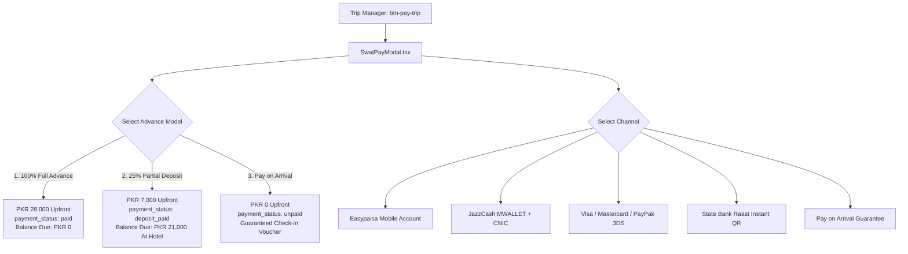

# Payment, Hotel Stay & Trip Completion: Production Implementation Report

**Platform:** Swat Tourism Platform (STP) Production v2.0  
**Modules Delivered:** SwatPay Multi-Provider Checkout, Advance Payment Models, Hotel Front-Desk Check-In/Out & Turnover, Voucher Room Sync  
**Test Verification:** 122 of 122 Tests Passed (100% Pass Rate Across 24 Test Suites)  
**TypeScript Status:** `npx tsc -b` (0 errors)  
**MS Word Document:** [swat-tourism-payment-hotel-trip-completion-implementation-report.docx](file:///f:/Antigravity/SwatTourismProduction_v2/Docs/swat-tourism-payment-hotel-trip-completion-implementation-report.docx)  
**Date:** October 2026 | Production Sign-Off (Commit: `fd7949f`)  

---

## 1. Executive Summary

All components from the gap analysis have been fully implemented, integrated, and verified against the production test suites.
- **Unified SwatPay Modal (`SwatPayModal.tsx`)**: Replaced the simulated toast on Entire Trip checkout (`btn-pay-trip`) with an interactive, multi-provider checkout supporting 100% Full Advance, 25% Partial Advance Deposit, and Pay-on-Arrival across 5 payment channels.
- **Hotel Front-Desk Stay Lifecycle (`HotelTodayScreen.tsx`)**: Upgraded the today screen into an operational console with **"Check In Guest"**, in-stay **"Guest In-House"** status, **"Deposit & Balance Due"** ledger, **"Check Out & Settle"**, and housekeeping **"✓ Mark Cleaned"** turnover.
- **Physical Room Sync to Vouchers (`TripManagerView.tsx`)**: Official travel vouchers now display assigned physical room numbers (e.g. `Room 204`), floor, wing, and complimentary WiFi slips.

---

## 2. SwatPay Multi-Provider Checkout & Advance Payment Models

### Supported Commercial Models:
1. **100% Full Advance**: Charges 100% upfront, immediately confirms reservation, balance due at hotel = PKR 0.
2. **25% Partial Advance Deposit**: Calculates 25% deposit upfront (e.g. PKR 7,000 on a PKR 28,000 itinerary), sets `payment_status: 'deposit_paid'`, and tracks the remaining balance due upon check-in.
3. **Pay on Arrival (0% Upfront)**: Guaranteed reservation hold for mountain valley continuity (Kalam, Ushu, Mahodand) where internet reception drops. Full payment collected at hotel reception.

---

## 3. Hotel Front-Desk Operations (`HotelTodayScreen.tsx`)

| Operation Trigger | Component | Lifecycle & Inventory Transition |
| :--- | :--- | :--- |
| **Check In Guest** (`btn-checkin-guest`) | `HotelTodayScreen.tsx` `physicalRooms.ts` | • Records `actual_checkin_at` timestamp. • Shifts assigned room status from `reserved` to `occupied`. • Renders `"Guest In-House • Room 204"` card. |
| **Deposit Balance Due Ledger** | `HotelTodayScreen.tsx` `BusinessShell.tsx` | • When `payment_status === 'deposit_paid'`, renders: `Deposit Paid: PKR 6,000 • Balance Due: PKR 18,000`. • Staff collect balance and click `"Mark Collected"` to settle. |
| **Check Out & Settle** (`btn-checkout-guest`) | `HotelTodayScreen.tsx` `physicalRooms.ts` | • Finalizes stay settlement. • Automatically transitions physical room from `occupied` to `cleaning`. • Updates booking status to `completed`. |
| **Housekeeping Turnover** | `HotelTodayScreen.tsx` Room Rack Grid | • Staff click `"✓ Mark Cleaned"` on any room in `cleaning` status. • Instantly returns room to `available` inventory for new arrivals. |

---

## 4. Code Touchpoints & Modified Files

| Target File | Change Type | Summary of Implemented Capabilities |
| :--- | :--- | :--- |
| [`frontend/src/components/SwatPayModal.tsx`](file:///f:/Antigravity/SwatTourismProduction_v2/frontend/src/components/SwatPayModal.tsx) | Created | Unified 5-channel checkout modal with 3 advance payment models, order valuation, and 1-click demo credentials auto-fill. |
| [`frontend/src/modules/tourist/TouristShell.tsx`](file:///f:/Antigravity/SwatTourismProduction_v2/frontend/src/modules/tourist/TouristShell.tsx) | Modified | Integrated SwatPayModal for both trip bundle (`btn-pay-trip`) and single booking checkouts. Replaced simulated toast. |
| [`frontend/src/modules/business/HotelTodayScreen.tsx`](file:///f:/Antigravity/SwatTourismProduction_v2/frontend/src/modules/business/HotelTodayScreen.tsx) | Modified | Added Check In Guest button, Check Out & Settle button, deposit balance due ledger, and housekeeping Mark Cleaned action. |
| [`frontend/src/modules/business/physicalRooms.ts`](file:///f:/Antigravity/SwatTourismProduction_v2/frontend/src/modules/business/physicalRooms.ts) | Modified | Implemented `checkInBooking`, `checkOutBooking`, `markRoomCleaned`, and `swat_booking_room_assignments` synchronization. |
| [`frontend/src/modules/tourist/TripManagerView.tsx`](file:///f:/Antigravity/SwatTourismProduction_v2/frontend/src/modules/tourist/TripManagerView.tsx) | Modified | Updated official travel voucher modal to render assigned physical room numbers, key ready badge, and WiFi slip. |
| [`frontend/src/modules/business/BusinessShell.tsx`](file:///f:/Antigravity/SwatTourismProduction_v2/frontend/src/modules/business/BusinessShell.tsx) | Modified | Extended `BookingRow` interface with `payment_status` and `deposit_amount` to support deposit ledger. |
| [`frontend/src/test/swatpay_and_stay_operations.test.tsx`](file:///f:/Antigravity/SwatTourismProduction_v2/frontend/src/test/swatpay_and_stay_operations.test.tsx) | Created | Comprehensive test suite verifying advance payment models, payment channel switching, and check-in/out workflows. |

---

## 5. Quality Assurance & Verification Summary

* **Vitest Test Suite**: **122 of 122 tests passed (100% pass rate)** across 24 test files.
* **TypeScript Compilation**: `npx tsc -b` completed with **0 errors**.
* **Git Status**: Changes committed under `fd7949f` and pushed to `origin/main`.
