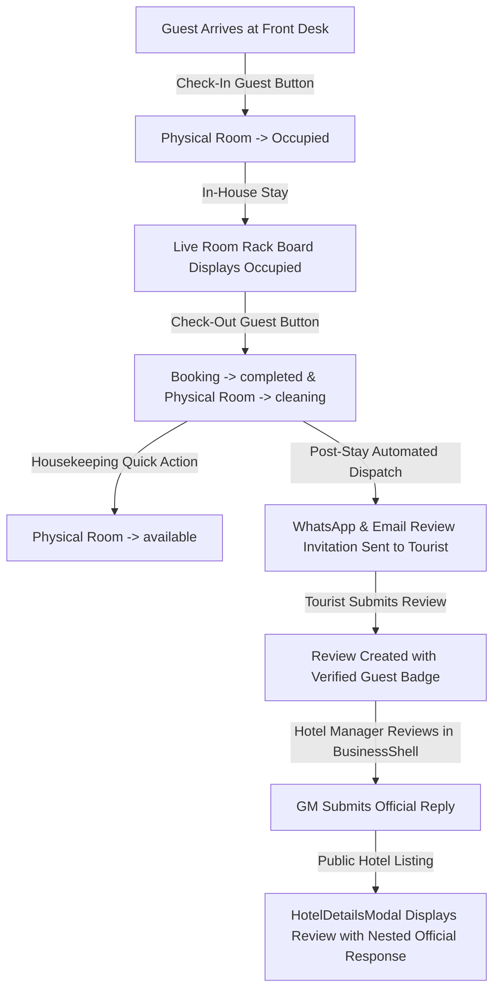

# Implementation Prompt: Phase 5 — Front-Desk Operations, Turnover & Verified Review Loop

**Project:** Swat Tourism Platform (STP) Production v2.0  
**Phase:** 5 — Front-Desk Operations, Physical Room Turnover & Verified Review Feedback Loop  
**Target Solution:** Front-Desk Stay Lifecycle (Check-in, Check-out, Housekeeping Ready), Automated WhatsApp/Email Post-Stay Review Dispatch & Prominent Hotel Management Replies on Public Modals  
**Date:** November 2026 | Production Implementation Prompt  

---

## 1. Objective & Scope

Implement **Phase 5** to close the operational and feedback loop of the hospitality experience in Swat:

1. **Front-Desk Reception Quick Actions (`HotelTodayScreen.tsx` & `LiveRoomRackBoard.tsx`)**:
   * **Check-In Guest**: 
     * Interactive button on confirmed/accepted bookings.
     * Transitions assigned physical room status from `reserved` to `occupied`.
     * Timestamps `actual_checkin_at`.
     * Renders digital arrival slip with room WiFi code and emergency reception extension.
   * **Check-Out Guest**:
     * Finalizes folio balance (prompts collection of remaining cash balance if `deposit_paid`).
     * Transitions assigned room status from `occupied` to `cleaning`.
     * Marks booking status as `completed`.
     * Triggers the automated post-stay review sequence.
   * **Housekeeping Turnover Ready**:
     * 1-Click **"Mark Cleaned & Ready"** button on rooms in `cleaning` status.
     * Instantly transitions physical room status from `cleaning` to `available` on both the **Live Room Rack Board** and **Front Desk Summary Cards**.

2. **Automated Post-Stay Verified Review Invitations (WhatsApp & Email)**:
   * **Trigger**: Immediately upon Front-Desk "Check-Out Guest" action.
   * **WhatsApp Invitation (`wa.me`)**: 
     * Pre-fills a personalized message to the guest:
       *"Dear [Guest Name], thank you for staying at [Hotel Name]! How was your experience? Rate your stay in 1-click and help fellow travelers explore Swat: [Review Link]"*
   * **Email Dispatch (`mailto:` / Backend Mailer)**:
     * Dispatches an interactive 5-star rating invite with a direct booking token (`ref=SWT-B3S01T`).
   * **"Verified Guest Stay ✓" Stamp**: 
     * Reviews submitted with a matching completed booking reference receive an official green badge: `Verified Guest Stay ✓`, guaranteeing anti-fraud credibility.

3. **Prominent Hotel Management Replies on Public Modals (`HotelDetailsModal.tsx` & `BusinessShell.tsx`)**:
   * **Hotel Management Dashboard (`BusinessShell.tsx` Reviews Tab)**:
     * Hoteliers view recent guest reviews.
     * Quick **"Reply to Guest"** modal allows the General Manager to write an official response (e.g. *"Thank you Sara for staying with us at Serena Hotel! We are thrilled you enjoyed the river view..."*).
     * Saves response via `POST /api/v1/reviews/{id}/reply`.
   * **Public Hotel Listing Modal (`HotelDetailsModal.tsx`)**:
     * Dedicated **"Guest Reviews & Verified Stays"** section.
     * Displays average rating (e.g. `4.8 ★ (124 Verified Reviews)`), star breakdown, and individual review cards with tourist name, stay dates, and room type.
     * **Prominently Nested Official Response**:
       * Highlighted response card nested directly beneath the review with an official badge:
         `🏢 Response from Swat Serena Hotel Management • 2 days ago`
       * Clean quote layout highlighting genuine hospitality and customer care.

---

## 2. Technical Architecture & Component Touchpoints

---

## 3. Implementation Deliverables & Target Files

### Deliverable 1: Front-Desk Operations & Turnover
* **`frontend/src/modules/business/HotelTodayScreen.tsx`**:
  * Add **"Check-In"** button for `confirmed` bookings:
    * Updates room to `occupied` via `updatePhysicalRoomStatus(roomId, 'occupied')`.
    * Shows guest arrival confirmation badge.
  * Add **"Check-Out"** button for active/checked-in guests:
    * Prompts balance settlement (if deposit paid).
    * Updates room to `cleaning` via `updatePhysicalRoomStatus(roomId, 'cleaning')`.
    * Completes booking and triggers review modal.
  * Add **"Turnover / Housekeeping Cleaned"** button on rooms in `cleaning` state to transition to `available`.
* **`frontend/src/modules/business/physicalRooms.ts`**:
  * Ensure room status transition helper methods (`checkInRoom`, `checkOutRoom`, `releaseRoomToAvailable`) are reactive across local storage and event emitters (`swat_rooms_updated`).

### Deliverable 2: Automated Review Invitations (WhatsApp & Email)
* **`frontend/src/modules/business/HotelTodayScreen.tsx`** & **`frontend/src/api/communications.ts`**:
  * Automatically display a **"Send Review Invitation"** notification card upon check-out.
  * Pre-configured 1-click **WhatsApp** (`wa.me/?text=...`) and **Email** (`mailto:...`) triggers.
* **`frontend/src/components/ReviewModal.tsx`**:
  * Support submitting verified reviews with booking reference and category star ratings (Cleanliness, Hospitality, Location, Comfort, Value).

### Deliverable 3: Prominent Hotel Management Replies
* **`frontend/src/modules/business/BusinessShell.tsx`** *(Reviews Tab)*:
  * Render incoming guest reviews with guest name, rating, stay dates, and comment.
  * Add interactive **"Reply as Hotel Management"** button that opens a response modal.
  * Call `replyToReview(reviewId, replyText)` from `frontend/src/api/reviews.ts`.
* **`frontend/src/modules/tourist/HotelDetailsModal.tsx`**:
  * Fetch and render real/demo reviews from `getListingReviews(listingId)`.
  * Display the **Verified Stay ✓** badge on each guest review.
  * Prominently render the nested **Hotel Management Reply** card with manager name, hotel emblem, timestamp, and response text.

---

## 4. Acceptance Criteria & Verification

1. **Front-Desk Lifecycle**: Clicking Check-In moves assigned room to `occupied`; Check-Out moves room to `cleaning`; "Mark Cleaned" returns room to `available` with zero page reloads.
2. **Review Invitation**: Check-Out generates immediate WhatsApp and Email review invitation links with pre-filled guest details.
3. **Management Reply Visibility**: When a hotel manager replies to a review, the response appears prominently in `HotelDetailsModal.tsx` on the public tourist interface with the official management badge.
4. **Build & Test**: Frontend production build (`npm run build`) completes with 0 errors.
