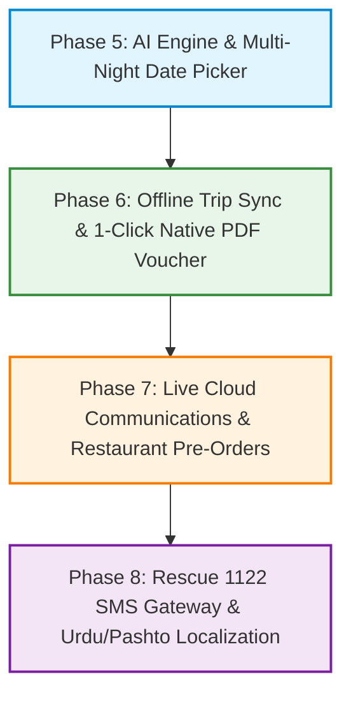

# Swat Tourism Platform — Comprehensive Functional Gap Analysis & Improvement Roadmap

**Audit Date:** November 05, 2026  
**Auditor:** Antigravity AI Engineering Team  
**Scope:** Post-Database Persistence Audit across Tourist, Business, Community, and Authority Ecosystems  
**Target Environment:** Production V2 (`F:\Antigravity\SwatTourismProduction_v2`)  

---

## Executive Summary

Following the completion of the **4-Phase Database Persistence Roadmap** and **End-to-End Multi-Role Lifecycle Verification**, the core platform has achieved durable transactional integrity for:
- Role isolation (Tourist, Hotel Manager, Transport Operator, Restaurant Owner, Community Member, Authority, Super Admin).
- Relational database persistence across 40 SQLite tables (physical hotel rooms, live cleaning turnover, transport fleet, balance collection, guest booking claiming, reviews, and host applications).

However, to elevate the platform from a functionally verified system to a commercial, enterprise-grade production platform ready for real mountain tourists and tourism operators, **8 functional gaps and improvement areas** remain.

---

## 1. High-Level Gap Matrix

| # | Functional Domain | Current Status | Identified Gap / Limitation | Business & Operational Impact | Priority |
| :-: | :--- | :--- | :--- | :--- | :-: |
| **1** | **AI Trip Generation Engine** | Heuristic client-side parser in `touristAIService.ts` | Disconnected from live database; does not dynamically match real hotel rates, 4x4 jeep availability, or restaurants from SQLite; no external web search fallback. | Users receive static itinerary suggestions rather than live, bookable itineraries tied to actual room/seat inventory. | **P0 (Critical)** |
| **2** | **Interactive Multi-Night Date Picker** | Single-date or daily capacity checks in `AvailabilityModal.tsx` | Missing dual-calendar range picker (Check-in to Check-out); no dynamic stay multiplier, holiday surcharge calculator, or live physical room blocking across multiple nights. | High friction for multi-day bookings; potential room conflict if check-out dates are not visually continuous. | **P1 (High)** |
| **3** | **Offline Trip Itinerary Synchronization** | Local draft trips stored in component state | When an unauthenticated visitor plans a trip with custom stops and later logs in/registers, itineraries are not auto-migrated to `trips` & `trip_stops` tables. | Tourists lose custom itineraries upon clearing browser cookies or switching devices. | **P1 (High)** |
| **4** | **1-Click Native PDF Voucher Export** | Printable HTML view `/bookings/{id}/voucher` | Browser-dependent print dialog only; missing bundled native PDF download (`.pdf` blob generation) optimized for offline phone storage in mountain dead zones. | Remote mountain areas beyond Bahrain have zero cellular connectivity; tourists need an offline PDF stored in their phone files. | **P1 (High)** |
| **5** | **Live Communications & Telecom Gateways** | Mock logger / Sandbox dispatcher | WhatsApp and Email dispatchers output to internal logs; no live Twilio / Meta Cloud WhatsApp webhook or SendGrid/SES production API keys. | Real SMS/WhatsApp messages and emails cannot be delivered to end-users without cloud provider credential configuration. | **P2 (Medium)** |
| **6** | **Restaurant Table & Meal Pre-Ordering** | View-only menu and contact numbers | Tourist cannot add dinner reservations or special Swati trout orders directly to their unified trip checkout or hotel folio. | Missed cross-selling revenue between hotels and local traditional restaurants. | **P2 (Medium)** |
| **7** | **Emergency 1122 CAD & Police Dispatch Bridge** | `sos_events` table + Authority alert banner | Distress calls do not auto-forward via SMS gateway or provincial Emergency 1122 CAD dispatch API. | Requires manual authority telephone monitoring rather than direct automated police/paramedic dispatch. | **P2 (Medium)** |
| **8** | **Multilingual (Urdu / Pashto) Localization** | English-only UI; database has partial `name_ur` | Complete language toggle (Urdu / Pashto / English) with RTL support for local drivers, community hosts, and domestic elders. | Usability barrier for local transport drivers and Swati craftswomen who are non-English speakers. | **P3 (Normal)** |

---

## 2. Detailed Technical Gap Analysis & Remediation Plans

---

### Gap 1: AI Trip Generation Engine with Live Database Matcher & Web Fallback
* **Requirement**: As specified in `Requirements.txt`:
  > *"i need the AI agen shoud create plan according to hotel,s transport, restaurant existing in application data base, if it doesnot find suitable hotel, transport, guide and restaurant, then it should search externally"*
* **Current State**:
  - `touristAIService.ts` contains hardcoded templates for 2-day and 3-day trips.
  - Stops are generated from hardcoded strings like `"Swat Serena Hotel"` and `"Swat Express"`.
* **Remediation Plan**:
  1. **Backend Endpoint `POST /api/v1/trips/ai-generate`**:
     - Accepts natural language prompt (e.g., *"3 days family trip from Lahore, budget 60k PKR, snow at Malam Jabba"*).
     - Extracts parameters: `origin_city`, `budget`, `duration_days`, `travellers`, `theme`, `destinations`.
     - Queries real SQLite database:
       - Verified hotels in target areas (Mingora, Malam Jabba, Kalam) with available rooms within budget.
       - Active 4x4 transport vehicles (`transport_vehicles` table) in Kalam.
       - Verified traditional restaurants (e.g., Adnan Platter House, Swat River Trout).
     - If local database results are insufficient (e.g. no luxury hotel in Mahodand), fallback to curated external mountain POI directory.
  2. **Unified Output**:
     - Returns populated `TripCreateInput` with real `listing_id`, real `price_item_id`, and estimated cost breakdown.

---

### Gap 2: Interactive Multi-Night Date Picker & Live Room Availability
* **Current State**:
  - `AvailabilityModal.tsx` lists 30 days of `Availability` records with numbers.
  - Booking request modal uses standard HTML `<input type="date">` inputs without range highlighting.
* **Remediation Plan**:
  1. Implement interactive visual date range calendar (Check-In $\rightarrow$ Check-Out) in `frontend/src/components/common/DateRangePicker.tsx`.
  2. Highlight disabled dates where physical rooms are either fully occupied (`status='occupied'`) or under maintenance.
  3. Real-time stay cost calculation:
     $$\text{Total Price} = \text{Nightly Rate} \times \text{Nights} \times \text{Rooms} + \text{Taxes/Fees}$$
  4. Instant availability feedback before checkout.

---

### Gap 3: Offline Trip Itinerary Synchronization (Gap 8)
* **Current State**:
  - `swat_local_bookings` is claimed on registration/login via `/bookings/claim`.
  - Unauthenticated tourists creating custom itineraries store them only in local state.
* **Remediation Plan**:
  1. Persist unauthenticated itinerary drafts to `localStorage.getItem('swat_local_trips')`.
  2. Create backend endpoint `POST /api/v1/trips/claim`:
     - Accepts list of draft trip objects.
     - Commits them to `trips` and `trip_stops` with `user_id = current_user.id`.
  3. Hook into `handleAuthSuccess` in `AuthContext.tsx` alongside booking claims.

---

### Gap 4: 1-Click Native PDF Booking Voucher & Receipt Export
* **Current State**:
  - `/bookings/{id}/voucher` renders a browser HTML page with `window.print()`.
* **Remediation Plan**:
  1. Add client-side PDF generation using `jspdf` and `html2canvas` directly in `BookingConfirmationModal.tsx` and `MyBookingsDedicatedView.tsx`.
  2. Provide a single `"Download Official PDF Pass"` button that instantly saves `KPCTA-Voucher-SWT-XXXX.pdf` to the tourist's phone/laptop without opening print dialogs.
  3. Ensure the PDF embeds the offline QR verification token, hotel GPS coordinates, helpline numbers, and room assignment.

---

### Gap 5: Live Communications Gateway (Production Credentials & Webhooks)
* **Current State**:
  - `WhatsAppService` and `EmailService` log formatted visual messages in the terminal and `/api/v1/communications/whatsapp/logs`.
* **Remediation Plan**:
  1. Add configuration environment flags in `.env`:
     - `WHATSAPP_PROVIDER=meta_cloud` | `twilio` | `mock`
     - `WHATSAPP_API_KEY`, `WHATSAPP_PHONE_NUMBER_ID`
     - `SMTP_HOST`, `SMTP_PORT`, `SMTP_USER`, `SMTP_PASSWORD`
  2. When flags are populated, dispatch real API HTTP calls to Twilio / Meta Cloud and SMTP servers with graceful fallback to logger.

---

### Gap 6: Restaurant Table Reservations & Meal Pre-Ordering
* **Current State**:
  - Restaurant cards display menus, photos, and contact phone numbers.
* **Remediation Plan**:
  1. Enable `"Reserve Table & Pre-Order Meal"` in `RestaurantDetailModal.tsx`.
  2. Allow tourists to add food items (e.g., Swati Trout Fry) to their trip itinerary or pay in advance via JazzCash / Easypaisa.
  3. Display incoming restaurant meal orders on the Restaurant Owner portal.

---

### Gap 7: Emergency 1122 & Police CAD Bridge
* **Current State**:
  - `EmergencySOSModal.tsx` captures GPS coordinates and creates `sos_events` row.
* **Remediation Plan**:
  1. Create automated SMS dispatch to Swat Tourist Police Control Room (`0946-9240400`) and Rescue 1122 with exact GPS link:
     ```
     SOS ALERT: Tourist Sara Ahmed (+923001234567) triggered emergency distress.
     Location: 35.4851, 72.5852 (Near Kalam Road).
     Google Maps: https://maps.google.com/?q=35.4851,72.5852
     ```

---

### Gap 8: Multilingual Localization (Urdu & Pashto)
* **Current State**:
  - Platform is English-only.
* **Remediation Plan**:
  1. Introduce lightweight i18n translation dictionary (`frontend/src/i18n/`).
  2. Add language switcher toggle in the navigation bar (`EN` | `اردو` | `پښتو`).
  3. Support RTL direction when Urdu or Pashto is selected.

---

## 3. Recommended Phased Implementation Roadmap



1. **Sprint 1 (Immediate Next Priority - P0/P1)**:
   - **AI Trip Planner Database Integration**: Query real SQLite listings (Hotels, Jeeps, Restaurants) with fallback.
   - **Multi-Night Interactive Date Picker**: Dynamic check-in to check-out calculation with real-time room rack status.
2. **Sprint 2 (P1)**:
   - **Offline Trip Sync**: Auto-migrate unauthenticated itineraries to account profile upon login.
   - **1-Click Native PDF Voucher**: Offline downloadable `.pdf` for mountain travelers.
3. **Sprint 3 (P2)**:
   - **Live Cloud Communications**: Real SMTP & WhatsApp API switch.
   - **Restaurant Table & Meal Booking**: Cross-booking meal vouchers into trips.
4. **Sprint 4 (P2/P3)**:
   - **Emergency 1122 CAD SMS Dispatch**.
   - **Urdu & Pashto UI Localization**.
