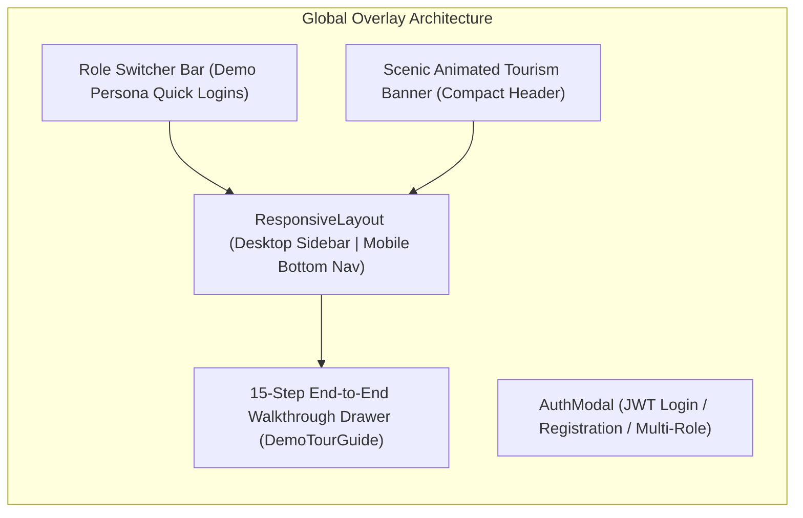
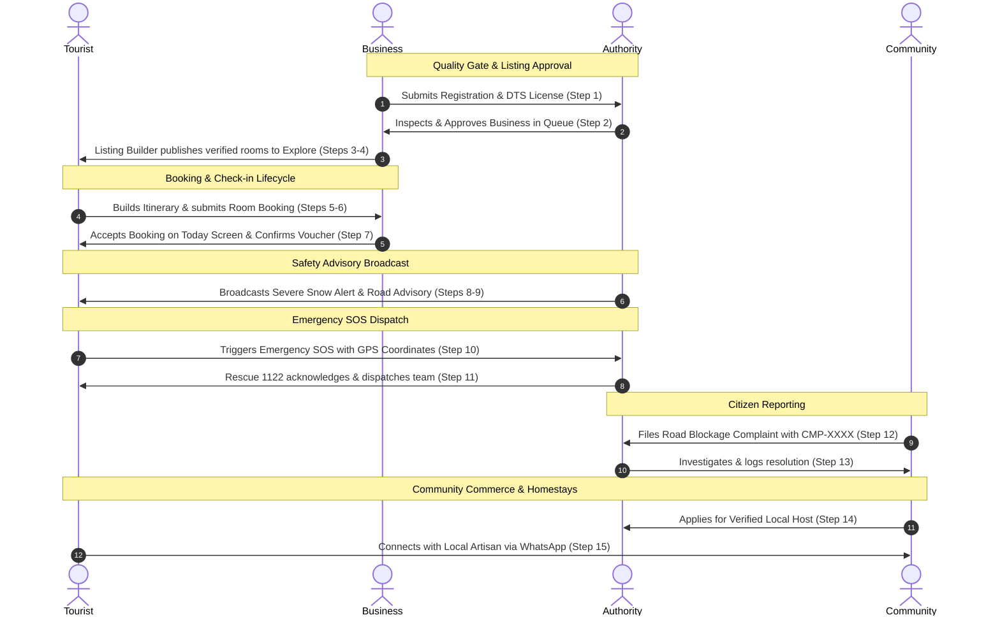

# Swat Tourism Platform — Comprehensive Application Site Map

**Document Version:** 1.0  
**Target Platform:** Swat Tourism Digital Ecosystem (Production Portal)  
**Architecture:** Multi-Role Web Portal (Tourist, Business, Community, Authority, Super Admin)  
**Date:** October 2026  

---

## 1. High-Level System Architecture & Navigation Flow

```mermaid
graph TD
    Root["Swat Tourism Digital Ecosystem"]
    
    %% Cross-cutting utilities
    Root --> TopBar["Top Utility & Demo Bar"]
    TopBar --> RoleSwitch["Role Switcher (Tourist | Business | Community | Authority | Admin)"]
    TopBar --> ViewSwitch["Layout Mode (Desktop | Phone Simulation)"]
    TopBar --> AuthMod["Auth Modal (Login | Register | Persona Select)"]
    TopBar --> TourGuide["15-Step Guided Walkthrough Drawer"]
    
    %% Portal Pillars
    Root --> P1["1. Tourist Portal"]
    Root --> P2["2. Business Portal"]
    Root --> P3["3. Community Voice Portal"]
    Root --> P4["4. Authority & Admin Dashboard"]
    
    %% Tourist Tabs
    P1 --> T_Home["Home Tab"]
    P1 --> T_Explore["Explore Tab"]
    P1 --> T_Trips["Trips Tab"]
    P1 --> T_Safety["Safety & SOS Tab"]
    P1 --> T_Profile["Profile Tab"]
    
    %% Business Tabs
    P2 --> B_Today["Today & KPI Tab"]
    P2 --> B_Listings["Listings & Builder Tab"]
    P2 --> B_Availability["60-Day Calendar Tab"]
    P2 --> B_Reviews["Reviews & Replies Tab"]
    P2 --> B_Profile["Profile & Verification Tab"]
    
    %% Community Tabs
    P3 --> C_Stories["Stories & Culture Tab"]
    P3 --> C_Crafts["Artisan Crafts Tab"]
    P3 --> C_Report["Citizen Report Form Tab"]
    P3 --> C_Hosts["Local Hosts Tab"]
    P3 --> C_Profile["Community Profile Tab"]
    
    %% Authority Tabs
    P4 --> A_Overview["Overview & KPIs Tab"]
    P4 --> A_Directory["Operator Directory Tab"]
    P4 --> A_Advisories["Advisories & Roads Tab"]
    P4 --> A_Approvals["Verification Queue Tab"]
    P4 --> A_Cases["Cases Desk (SOS & Reports)"]
```



---

## 2. Detailed Portal Site Map

### Pillar 1: Tourist Portal (`role === 'tourist'`)
*Primary Objective: Valley discovery, multi-day itinerary planning, hotel room reservations, safety, and local culture.*

| Tab ID | Page Title | Sub-Views / Modals | Primary Actions & Data |
| :--- | :--- | :--- | :--- |
| **`home`** | **Home Screen** | • Scenic Animated Banner<br>• Weather Advisory Banner<br>• Weather Forecast Modal<br>• Interactive Valley Map Modal | • Hero search for valleys & destinations<br>• Popular destination cards (Kalam, Mahodand, Malam Jabba, Ushu)<br>• Live OpenWeatherMap API forecast (5-day projection, altitude, coordinates)<br>• MapLibre interactive pin explorer |
| **`explore`** | **Explore & Discovery** | • Hotel Details Modal<br>• Restaurant Details Modal<br>• Service Details Modal | • Faceted category filter chips (All, Hotels, Food, Transport, Guides, Activities, Shops)<br>• Verified listings directory with nightly rates<br>• View all rooms, facilities, and activities<br>• Restaurant menu preview & direct calling<br>• One-click "Add to Itinerary" |
| **`trips`** | **Trips & Itinerary Manager** | • MyTripsListView<br>• "+ New Trip" Modal<br>• 3-View TripManagerView<br>• Booking Voucher Modal<br>• Easypaisa Payment Modal | • **View 1 (Itinerary):** Day-by-day stops, hotel room type selector per day, distance/travel times, assigned driver badge, continuity pills<br>• **View 2 (Bookings):** Booking status pills, QR booking voucher generator, cancellation preview<br>• **View 3 (Details):** Budget calculator, emergency contacts, shareable trip text generator<br>• Digital checkout & payment receipt |
| **`safety`** | **Safety & Emergency Hub** | • Emergency SOS Trigger Modal<br>• Road Condition Cards<br>• 1-Tap Emergency Directory | • Instant 1-tap calling: Rescue 1122, Tourist Police (1422), DHQ Hospital, Edhi<br>• Live Road Status tags (Clear, 4x4 Required, Snow Chains, Blocked)<br>• GPS distress beacon trigger with 5-second countdown & live coordinates |
| **`profile`** | **Traveler Profile** | • Profile Editor<br>• Booking History<br>• Saved Bookmarks | • Maintain traveler name, origin city, nationality, emergency contacts<br>• Select travel interest chips (Adventure, Heritage, Family, Photography)<br>• Inspect past, active, and cancelled trip reservations |

---

### Pillar 2: Business Portal (`role === 'business'`)
*Primary Objective: Merchant operations, dynamic room & service management, 60-day visual availability calendar, bookings handling, and review replies.*

| Tab ID | Page Title | Sub-Views / Modals | Primary Actions & Data |
| :--- | :--- | :--- | :--- |
| **`today`** | **Daily Operations (Today)** | • Booking Acceptance Modal<br>• Decline Reason Modal<br>• Guest Check-in Actions | • Real-time operational KPI counters (Today's arrivals, active guests, open requests, monthly gross PKR revenue)<br>• Live incoming booking requests queue<br>• Accept / Decline with custom reason note<br>• Mark guest arrival / completion |
| **`listings`** | **Catalog & Listings** | • ListingBuilderModal<br>• BusinessServicesManagerModal | • View published and draft listings<br>• Dynamic listing builder supporting 6 categories (Hotels, Restaurants, Transport, Guides, Activities, Shops)<br>• Configure room types (Deluxe, Suite, Family), nightly prices, max capacity, and amenities<br>• Upload individual room and property photos |
| **`availability`**| **Availability Calendar** | • 60-Day Visual Grid<br>• Room Inventory Editor<br>• Price Adjuster | • Visual interactive 60-day availability calendar matrix<br>• Daily inventory toggles (prevent overbooking)<br>• Seasonal nightly rate overrides in PKR |
| **`reviews`** | **Reviews & Trust** | • Public Management Reply Box<br>• Guest Rating Breakdown | • Overall guest review score (1 to 5 stars)<br>• Category ratings (cleanliness, staff, location, value)<br>• Post public business responses to guest reviews |
| **`profile`** | **Business Profile & KYC** | • Verification Document Upload<br>• Business License Editor | • Maintain legal business name, NTN, CNIC, phone, address<br>• Upload CNIC front/back and Department of Tourist Services (DTS) license<br>• Track verification status (`unsubmitted`, `pending_verification`, `verified`, `rejected`) |

---

### Pillar 3: Community Voice Portal (`role === 'community'`)
*Primary Objective: Local culture, artisanal e-commerce, citizen incident reporting, and verified local experience hosts.*

| Tab ID | Page Title | Sub-Views / Modals | Primary Actions & Data |
| :--- | :--- | :--- | :--- |
| **`stories`** | **Local Culture & Stories** | • "Share a Story" Modal<br>• Culture Photo Viewer | • Browse published stories of Swat folklore, traditions, and hidden trails<br>• Community members submit original stories with photos and valley tags |
| **`crafts`** | **Artisan Products Directory**| • Product Showcase<br>• Direct WhatsApp Connect | • Browse authentic local products (Islampur woolen shawls, Swat honey, gemstones, hand-carved woodwork)<br>• Direct WhatsApp messaging connection with local cottage artisans |
| **`report`** | **Citizen Incident Report** | • Incident Reporting Form<br>• Photo & Evidence Uploader<br>• GPS Auto-Capture | • Report road blockages, land sliding, littering/trash, or commercial overcharging<br>• Auto-populate current GPS coordinates<br>• Auto-generate tracking token (`CMP-XXXX`) |
| **`hosts`** | **Local Experience Hosts** | • Become a Host Application<br>• Verified Host Directory | • Local residents apply to host homestays, trekking tours, or cultural workshops<br>• Browse verified local community guides with bios and contact channels |
| **`profile`** | **Community Profile** | • Host Bio Editor<br>• Community Credentials | • Maintain resident name, village/valley, spoken languages, and hosting status |

---

### Pillar 4: Authority & Admin Dashboard (`role === 'authority' | 'admin'`)
*Primary Objective: Regulatory oversight, business verification quality gate, emergency dispatch, travel advisories, and citizen report resolution.*

| Tab ID | Page Title | Sub-Views / Modals | Primary Actions & Data |
| :--- | :--- | :--- | :--- |
| **`overview`** | **Executive Intelligence** | • Real-Time KPI Cards<br>• Origin Analytics Chart<br>• Density Breakdown | • Executive metrics: Verified businesses, total tourist arrivals, active road blockages, open SOS cases<br>• Tourist origin distribution (KP, Punjab, Sindh, International)<br>• Valley visitation density breakdown (Kalam vs Malam Jabba vs Marghazar) |
| **`directory`** | **Master Operator Directory** | • Business Inspection Drawer<br>• Suspension Controls | • Master registry of all registered operators across Swat District<br>• Filter by category, valley, verification status, and license number<br>• Action to flag or suspend non-compliant operators |
| **`advisories`** | **Safety & Road Advisories** | • Advisory Composer<br>• Road Condition Switcher | • Publish emergency weather, flood, and safety bulletins (Advisory, Warning, Critical) with global banner broadcast<br>• Live road status toggle (Clear, Snow Chains, 4x4 Jeep Only, Closed/Landslide) |
| **`approvals`** | **Verification Quality Gate** | • Document Preview Desk<br>• Approve Action<br>• Request Changes Action | • Business verification queue for newly submitted registrations<br>• Inspect uploaded CNIC, NTN tax forms, and DTS hospitality licenses<br>• One-click Approve (activates listing in public tourist search)<br>• Request Changes with formal feedback note |
| **`cases`** | **Safety & Incident Cases** | • **Sub-Tab 1: 🚨 SOS Emergencies**<br>• **Sub-Tab 2: 📋 Community Reports** | • **SOS Dispatch Desk:** Live emergency distress queue from tourists with GPS coordinates, phone, medical notes; dispatch Rescue 1122 and mark resolved<br>• **Community Reports Desk:** Investigate citizen complaints (landslides, litter, overcharging); log actions taken and resolve cases |

---

## 3. Global & Cross-Cutting Application Components



1. **Top Animated Scenic Tourism Banner ([`TourismAnimatedBanner.tsx`](file:///f:/Antigravity/SwatTourismProduction/frontend/src/components/TourismAnimatedBanner.tsx)):**
   - High-efficiency compact header displaying live Government of KP verified status.
   - Dynamic auto-rotating destination ticker (Malam Jabba, Mahodand Lake, Kalam Valley, White Palace Marghazar, Gandhara Heritage).
   - Live temperature and weather readout with quick destination switcher dots.
2. **Global Role Switcher & Device Simulator ([`RoleSwitcherBar.tsx`](file:///f:/Antigravity/SwatTourismProduction/frontend/src/components/RoleSwitcherBar.tsx)):**
   - Instant one-click persona switching (Tourist Sara Ahmed, Business Riverside Inn, Community Gul Zaman, Authority Tourism Officer, Admin Master).
   - View mode toggle (Auto Responsive, Forced Desktop, Phone Simulator mode).
   - Theme toggle (Light / Dark mode).
3. **Interactive 15-Step Platform Walkthrough Drawer ([`DemoTourGuide.tsx`](file:///f:/Antigravity/SwatTourismProduction/frontend/src/components/DemoTourGuide.tsx)):**
   - Persistent bottom dock stepper showcasing the end-to-end multi-role ecosystem without permissions friction.
   - Auto-navigates and switches roles across all 15 operational steps with zero access denied screens.
4. **Universal Authentication Modal ([`AuthModal.tsx`](file:///f:/Antigravity/SwatTourismProduction/frontend/src/components/AuthModal.tsx)):**
   - Tabbed login and registration for Tourists, Businesses, Community members, and Authority officers.
   - Mock JWT authentication and session state storage.

---

## 4. Cross-Portal Interconnectivity Matrix

The platform is a unified ecosystem where actions in one portal trigger immediate operational state changes across other portals:



---

## 5. Summary Route & Tab Quick-Reference

```
/ (Root)
│
├── TOURIST PORTAL
│   ├── /?role=tourist&tab=home          (Featured spots, live weather, valley map)
│   ├── /?role=tourist&tab=explore       (Category filters, verified stays, dining, guides)
│   ├── /?role=tourist&tab=trips         (Multi-day itinerary planner, bookings, vouchers)
│   ├── /?role=tourist&tab=safety        (Emergency 1122 directory, road statuses, SOS beacon)
│   └── /?role=tourist&tab=profile       (Traveler pass, origin city, preferences, history)
│
├── BUSINESS PORTAL
│   ├── /?role=business&tab=today        (Daily arrivals, KPI revenue, accept/decline queue)
│   ├── /?role=business&tab=listings     (Listing builder, room types, photo manager)
│   ├── /?role=business&tab=availability (60-day interactive capacity & pricing calendar)
│   ├── /?role=business&tab=reviews      (Guest star ratings, management public replies)
│   └── /?role=business&tab=profile      (KYC registration, DTS license document upload)
│
├── COMMUNITY PORTAL
│   ├── /?role=community&tab=stories     (Folklore articles, cultural photo share form)
│   ├── /?role=community&tab=crafts      (Islampur shawls, honey, direct WhatsApp chat)
│   ├── /?role=community&tab=report      (Citizen complaint filing, GPS auto-fill, CMP tracking)
│   ├── /?role=community&tab=hosts       (Local host applications, homestay guide directory)
│   └── /?role=community&tab=profile     (Community resident bio, village, languages)
│
└── AUTHORITY & ADMIN DASHBOARD
    ├── /?role=authority&tab=overview    (Executive KPI intelligence, tourist footfall stats)
    ├── /?role=authority&tab=directory   (Master operator registry, category filters)
    ├── /?role=authority&tab=advisories  (Weather/flood bulletin composer, road status toggle)
    ├── /?role=authority&tab=approvals   (Regulatory inspection desk, approve/request changes)
    └── /?role=authority&tab=cases       (Rescue 1122 SOS dispatch queue, citizen complaints)
```
