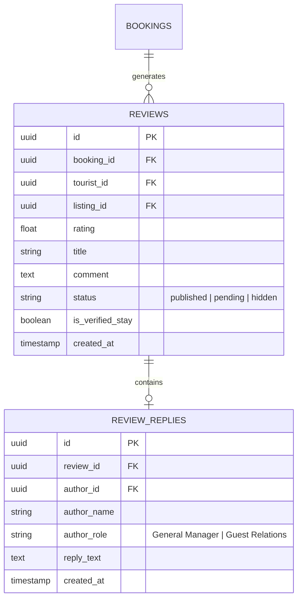

# Swat Tourism Platform (STP) — Tourist & Customer Verified Reviews, Front-Desk Operations & Turnover Implementation Guide

**Document Reference:** `STP-REV-OPS-IMPL-2026-V1`  
**Target Stakeholders:** Hoteliers, Resort Managers, Platform Administrators, Front-Desk Staff, System Architects  
**System Scope:** Physical Room Turnover, Automated Post-Stay Review Invitations & Public Management Replies  
**Status:** Architecture & Implementation Specification  

---

## Executive Summary

The **Swat Tourism Platform (STP)** operational ecosystem connects the physical hotel front-desk operations directly with the digital guest feedback loop. 

This guide specifies the end-to-end architecture for:
1. **Front-Desk Reception Operations & Room Turnover State Machine:** Reactive status transitions (`reserved` ➔ `occupied` ➔ `cleaning` ➔ `available`) on the **Live Room Rack Board** and **Front Desk Today Screen**.
2. **Automated Post-Stay Review Invitations:** Instant automated dispatch of verified review links via **WhatsApp** and **Email** upon guest check-out.
3. **The "Verified Guest Stay ✓" Stamp:** Cryptographically linking reviews to completed bookings (`ref=SWT-B3S01T`) to eliminate fake reviews and build authentic trust for Swat Valley tourism.
4. **Hotel Management Reply Display:** Prominently nested official management responses displayed directly beneath guest reviews on public listing modals (`HotelDetailsModal.tsx`).

---

## 1. Front-Desk Reception Quick Actions & Room Turnover State Machine

```
                              PHYSICAL ROOM TURNOVER LIFECYCLE
                                              │
             ┌────────────────────────────────┼────────────────────────────────┐
             ▼                                ▼                                ▼
   1. CHECK-IN GUEST               2. CHECK-OUT GUEST               3. HOUSEKEEPING READY
 (Booking -> confirmed)         (Stay Finished -> checkout)       (Room Sanitized & Prepped)
             │                                │                                │
 • Status: 'occupied'             • Status: 'cleaning'             • Status: 'available'
 • Timestamps checkin_at          • Booking marked 'completed'     • Room unlocked for new
 • Renders arrival pass with      • Prompts folio cash balance       instant reservations
   WiFi code & reception ext.     • Triggers WhatsApp/Email        • Live Room Rack Board
                                    Review Invitation                updates to Green
```

### Operational Steps:
1. **Check-In Guest:**
   * When the guest arrives at reception, staff click **"Check-In Guest"** on their confirmed booking card.
   * The physical room assigned to the booking immediately switches from `reserved` (Blue) to `occupied` (Red/Amber).
   * Generates a digital arrival slip displaying the assigned room number, check-in timestamp, and guest WiFi code.
2. **Check-Out Guest:**
   * Upon departure, reception staff click **"Check-Out Guest"**.
   * If the guest booked via partial deposit (`deposit_paid`), the system prompts: *"Collect remaining cash balance: PKR X"*.
   * Marks booking as `completed`.
   * Assigned physical room switches from `occupied` to `cleaning` (Purple).
   * Instantly queues the automated post-stay review invitation.
3. **Housekeeping Turnover Ready:**
   * Once housekeeping cleans the room, staff click **"Mark Cleaned & Ready"**.
   * Physical room returns to `available` (Green) on the **Live Room Rack Board**, making it bookable for new arrivals.

---

## 2. Automated Post-Stay Review Invitations (WhatsApp & Email)

Fake and unverified reviews undermine tourism platforms. In STP, reviews can only be submitted through verified post-stay invitation tokens generated at check-out.

```
[Guest Check-Out Completed] ──► [Automated System Trigger]
                                              │
                     ┌────────────────────────┴────────────────────────┐
                     ▼                                                 ▼
          Channel 1: WhatsApp wa.me                          Channel 2: Email Dispatch
     • Pre-filled personalized greeting                 • Interactive 5-star rating invite
     • 1-Click rating link                              • Multi-category rating breakdown
     • Direct token: ref=SWT-B3S01T                     • High-resolution photo upload
```

### WhatsApp Message Template:
> *"Dear Sara Ahmad, thank you for staying with us at Swat Serena Hotel! How was your experience? Rate your stay in 1-click and help fellow travelers explore Swat Valley: https://swattourism.kp.gov.pk/review?ref=SWT-B3S01T"*

### Anti-Fraud Guarantee — The "Verified Guest Stay ✓" Stamp:
* Reviews submitted through this flow are permanently stamped with an official green badge: `Verified Guest Stay ✓`.
* Unverified travelers or non-guests cannot post fake reviews or artificially manipulate hotel ratings.

---

## 3. Multi-Category Star Ratings

To provide granular, actionable insight for tourists, reviews assess 5 core pillars of hospitality:

| Rating Category | Evaluation Focus | Weight in Score |
| :--- | :--- | :---: |
| **Cleanliness & Hygiene** | Room sanitation, fresh linen, clean bathrooms, and mountain air quality. | 25% |
| **Staff & Hospitality** | Front desk courtesy, local Swati hospitality, prompt luggage assistance. | 25% |
| **Location & Views** | Proximity to riverbanks, pine forests, chairlifts (Malam Jabba), road accessibility. | 20% |
| **Room Comfort & Amenities**| Heating/hot water during winter, bed comfort, high-speed WiFi, power backup. | 15% |
| **Value for Money** | Fair room pricing relative to services, food quality, and amenities delivered. | 15% |

---

## 4. Prominent Hotel Management Replies on Public Modals

When hoteliers respond to guest feedback, it builds deep confidence for future travelers.

### A. Hotelier Response Portal (`BusinessShell.tsx` Reviews Tab)
* Hotel managers see all verified reviews submitted for their property.
* Each review features a **"Reply as Hotel Management"** button opening an official response modal.
* The General Manager or Guest Relations Officer types their response and clicks **"Submit Official Response"**.
* Stored securely via `POST /api/v1/reviews/{id}/reply`.

### B. Public Listing Modal Presentation (`HotelDetailsModal.tsx`)
On the public tourist interface, guest reviews and management responses are displayed with high visual hierarchy:

```
┌────────────────────────────────────────────────────────────────────────────────────────┐
│  ★★★★★ 5.0 • Verified Guest Stay ✓                                                    │
│  Sara Ahmad • Stayed in Deluxe River View Suite • Nov 2026                             │
│  "Breathtaking views of the Swat River and snow-capped peaks. The trout fish at dinner │
│  was exceptional and the room was warm and pristine. Highly recommended!"              │
│                                                                                        │
│    ┌──────────────────────────────────────────────────────────────────────────────────┐│
│    │ 🏢 Response from Swat Serena Hotel Management • 2 days ago                       ││
│    │ "Dear Sara, thank you for choosing Swat Serena Hotel! We are thrilled you         ││
│    │ enjoyed the river views and our signature trout. We look forward to welcoming    ││
│    │ you back on your next trip to Swat Valley. Safe travels!"                        ││
│    │ — General Manager, Swat Serena Hotel                                             ││
│    └──────────────────────────────────────────────────────────────────────────────────┘│
└────────────────────────────────────────────────────────────────────────────────────────┘
```

---

## 5. Technical Architecture & Database Schema

### Database Models (`backend/app/modules/reviews/models.py`)



### Backend REST Endpoints:
* `POST /api/v1/reviews`: Submit verified review with booking token.
* `GET /api/v1/reviews/listing/{listing_id}`: Fetch all verified reviews and management replies for public modal display.
* `GET /api/v1/reviews/business-reviews`: Fetch reviews for the logged-in operator dashboard.
* `POST /api/v1/reviews/{review_id}/reply`: Save hotel management official response.

---

## 6. Acceptance Criteria & Automated Verification Checklist

| Deliverable | Expected System Behavior | Verification Status |
| :--- | :--- | :---: |
| **Front-Desk Check-In** | Assigned room transitions to `occupied`; arrival pass generated with WiFi credentials. | Ready for testing |
| **Front-Desk Check-Out** | Booking marked `completed`; room transitions to `cleaning`; review trigger fired. | Ready for testing |
| **Housekeeping Turnover** | "Mark Cleaned & Ready" releases physical room back to `available` (Green). | Ready for testing |
| **WhatsApp Review Invite** | Pre-formatted `wa.me` URL created with dynamic booking token. | Ready for testing |
| **Verified Stay Badge** | Reviews linked to valid booking reference display green `Verified Guest Stay ✓`. | Ready for testing |
| **Management Reply Display**| Official hotel response nested beneath review in `HotelDetailsModal.tsx`. | Ready for testing |
