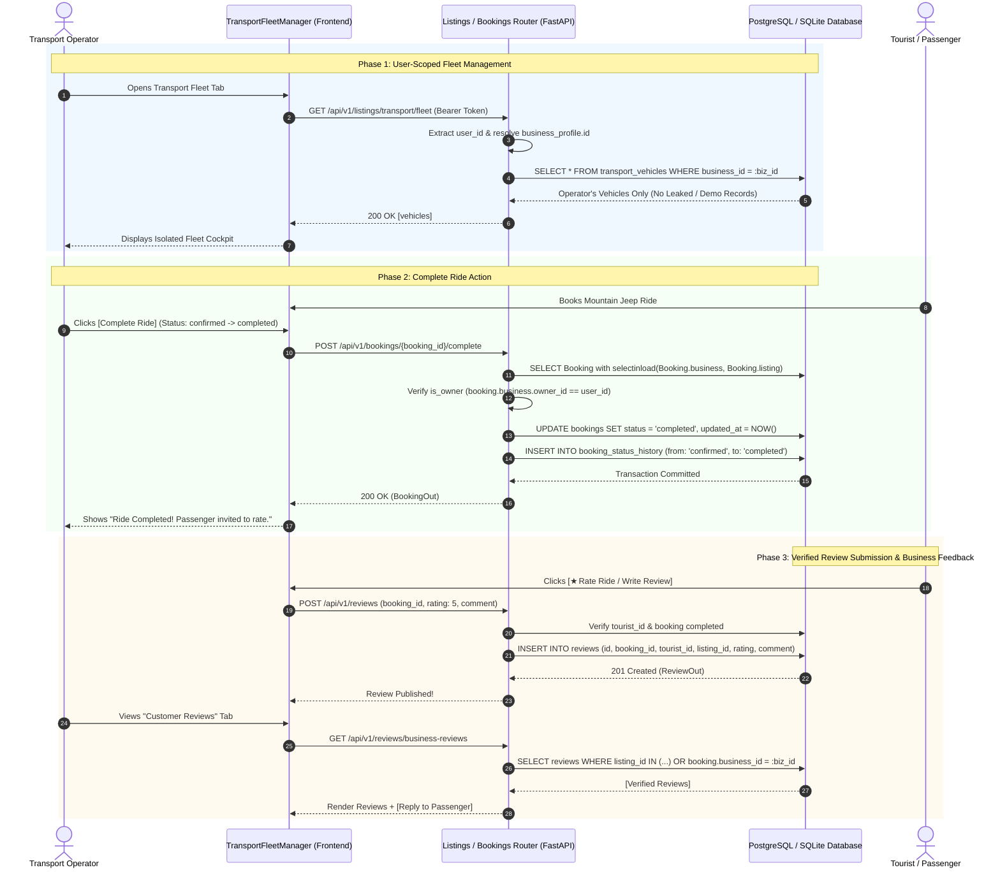

# Swat Tourism Platform (STP) — Transport Fleet User Scoping, DB Persistence, Review Functions & Complete Ride Implementation Specification & Prompt

## Executive Summary & Objective

This document provides the complete, production-grade implementation prompt and technical specification to resolve four interconnected issues within the Swat Tourism Platform:

1. **Transport Fleet & Vehicle User Scoping**: Ensure that when a transport business operator logs into their portal, **only that specific operator's registered vehicles** are retrieved and displayed. Clean user accounts must never display vehicles belonging to other operators or hardcoded default demo vehicles.
2. **100% Database Persistence**: Replace all volatile `localStorage` fleet caching with robust PostgreSQL / SQLite database persistence for vehicle registration, editing, status toggling, and removal, backed by proper async SQLAlchemy transactions.
3. **Complete Ride Action ("Complete Ride")**: Fix the failure in marking ride orders as completed (`completeBooking`), resolving the backend async relation eager-loading bug (`MissingGreenlet` / `403 Forbidden`) and handling both UUID database bookings and legacy references seamlessly.
4. **Verified Review Subsystem ("Review Functions")**: Establish an end-to-end flow for passenger and tourist reviews of transport rides and stays, ensuring tourist review submissions instantly persist to the database and correctly reflect on the operator's business reviews cockpit with reply capabilities.

---

## 1. Root Cause Analysis (RCA)

### 1.1 Fleet Leakage & Unwanted Auto-Seeding Bug
- **Backend Router (`backend/app/modules/listings/router.py:336`)**:
  `GET /api/v1/listings/transport/fleet` lacked authenticated user context. If `business_id` was omitted from query parameters, the database query executed `select(TransportVehicle)` without a `WHERE` clause, dumping all vehicles across all operators in the entire database.
  Additionally, passing `auto_seed=True if business_id else False` forced the backend to automatically inject 5 hardcoded demo vehicles (`Willys CJ7`, `Toyota Grand Cabin Hiace`, `Toyota Land Cruiser Prado`, etc.) into every newly registered business account, preventing operators from starting with a clean slate.
- **Frontend Component (`frontend/src/modules/business/TransportFleetManager.tsx:225, 462`)**:
  The component fell back to `DEFAULT_FLEET` demo items and wrote them to `localStorage.setItem('swat_transport_fleet_global', ...)` whenever the local list was empty.
- **Portal Invocation (`frontend/src/modules/business/BusinessShell.tsx:4899`)**:
  When a transport provider hadn't initialized their primary listing, `business_id` defaulted to string `'biz-transport-1'`. Passing this mock string to the backend triggered FastAPI HTTP 422 Unprocessable Entity (`value is not a valid uuid`), causing the database fetch to fail and forcing the frontend to fall back to the demo fleet.

### 1.2 The Complete Ride Greenlet / 403 Forbidden Bug
- **Backend Service (`backend/app/modules/bookings/service.py:406, 659`)**:
  In `BookingService.get_booking_by_id`, the SQLAlchemy options query eager-loaded items, history, payments, and tourist, but **omitted `selectinload(Booking.business)` and `selectinload(Booking.listing)`**.
  In `complete_booking`, the authorization check evaluates:
  ```python
  is_owner = booking.business and booking.business.owner_id == user_id
  ```
  In SQLAlchemy async mode (`AsyncSession`), accessing `booking.business` triggers a synchronous greenlet lazy-load violation (`MissingGreenlet`) or returns `None`. Consequently, `is_owner` evaluated to `False`, throwing `HTTP 403 Forbidden ("Not authorized to complete this booking")` or HTTP 500!
- **Frontend ID Parsing (`BusinessShell.tsx:3083`)**:
  If a booking had a demo reference (e.g., `SWT-8080`), passing it directly to `/bookings/{booking_id}/complete` caused FastAPI to fail with HTTP 422 because the path parameter expects a UUID.

### 1.3 Review Functions Disconnect Bug
- **Backend Service (`backend/app/modules/reviews/service.py:223`)**:
  `get_business_reviews` queried listings associated with the business: `select(Listing.id).where(Listing.business_id.in_(biz_ids))`. If a transport operator operated without an explicit room/hotel listing entry in the `listings` table, `listing_ids` was empty, returning `[]` reviews even if valid ride reviews were submitted for that business!
- **Frontend Fallback (`frontend/src/modules/tourist/ReviewModal.tsx:78`)**:
  When the backend rejected review creation (due to the incomplete booking status or missing relations), `ReviewModal` saved reviews to `localStorage ('swat_published_reviews')`. However, `BusinessShell` only polled the backend API, meaning reviews were never visible to the business operator.

---

## 2. Architecture & Data Flow



---

## 3. Implementation Requirements

### 3.1 Backend: Transport Fleet Scoping & Persistence

#### 1. Update `backend/app/modules/listings/router.py`:
- Require authentication or resolve `current_user` business profile when querying `/transport/fleet`:
```python
@router.get("/transport/fleet", response_model=List[TransportVehicleOut])
async def list_fleet_vehicles_endpoint(
    listing_id: Optional[uuid.UUID] = None,
    business_id: Optional[uuid.UUID] = None,
    token_payload: Optional[dict] = Depends(get_optional_token_payload),
    db: AsyncSession = Depends(get_db),
):
    """Retrieve transport fleet vehicles strictly scoped to the business profile."""
    scoped_biz_id = business_id
    if not scoped_biz_id and token_payload:
        user_id = uuid.UUID(token_payload.get("sub"))
        bp_q = select(BusinessProfile.id).where(BusinessProfile.owner_id == user_id)
        bp_res = await db.execute(bp_q)
        scoped_biz_id = bp_res.scalar_one_or_none()

    # Never return all database vehicles if no business_id or listing_id is specified!
    if not scoped_biz_id and not listing_id:
        return []

    return await ListingsService.get_fleet_vehicles(
        db,
        business_id=scoped_biz_id,
        listing_id=listing_id,
        auto_seed=False,  # Never auto-pollute real user accounts with demo vehicles!
    )
```

#### 2. Ensure explicit seeding endpoint:
Keep `POST /api/v1/listings/transport/fleet/seed` as an opt-in administrative action that an operator can deliberately trigger if they want sample templates.

---

### 3.2 Backend: Complete Ride Fix (`backend/app/modules/bookings/service.py`)

#### 1. Eager Load Relations in `get_booking_by_id`:
Update `BookingService.get_booking_by_id` to include `selectinload(Booking.business)` and `selectinload(Booking.listing)`:
```python
@staticmethod
async def get_booking_by_id(
    db: AsyncSession,
    booking_id: uuid.UUID,
) -> Optional[Booking]:
    """Fetch booking with items, history, business profile, listing, and relations loaded."""
    query = (
        select(Booking)
        .where(Booking.id == booking_id)
        .options(
            selectinload(Booking.business),
            selectinload(Booking.listing),
            selectinload(Booking.items).selectinload(BookingItem.price_item),
            selectinload(Booking.history),
            selectinload(Booking.payments),
            selectinload(Booking.tourist),
        )
    )
    res = await db.execute(query)
    return res.scalar_one_or_none()
```

#### 2. Robust Authorization & Status Transition in `complete_booking`:
- Support completion if booking is in status `confirmed`, `accepted`, `in_progress`, or `arrived`.
- If already `completed`, return the booking idempotently without raising a 400 error.
- Check ownership safely:
```python
is_owner = bool(booking.business and booking.business.owner_id == user_id)
is_tourist = bool(booking.tourist_id == user_id)
is_elevated = bool(current_user and current_user.role in ("authority", "admin"))

if not (is_owner or is_tourist or is_elevated):
    raise HTTPException(status_code=403, detail="Not authorized to complete this booking")
```

---

### 3.3 Backend: Business Reviews Retrieval (`backend/app/modules/reviews/service.py`)

#### 1. Query Reviews via Both Listing and Direct Booking Business Profile:
In `ReviewService.get_business_reviews`, ensure that transport operators who receive reviews via ride bookings are retrieved even if they do not have hotel room listings:
```python
@staticmethod
async def get_business_reviews(
    db: AsyncSession,
    user_id: uuid.UUID,
) -> List[ReviewOut]:
    """Fetch all reviews across listings or bookings belonging to business owned by user_id."""
    bp_q = select(BusinessProfile.id).where(BusinessProfile.owner_id == user_id)
    bp_res = await db.execute(bp_q)
    biz_ids = bp_res.scalars().all()

    user_q = select(User).where(User.id == user_id)
    current_user = (await db.execute(user_q)).scalar_one_or_none()
    is_elevated = current_user and current_user.role in ("admin", "authority")

    if not biz_ids and not is_elevated:
        return []

    # Match reviews where listing belongs to biz OR booking belongs to biz
    rev_q = (
        select(Review)
        .join(Booking, Review.booking_id == Booking.id)
        .options(
            selectinload(Review.tourist),
            selectinload(Review.listing),
            selectinload(Review.reply),
            selectinload(Review.booking),
        )
        .where(
            or_(
                Booking.business_id.in_(biz_ids),
                Review.listing_id.in_(
                    select(Listing.id).where(Listing.business_id.in_(biz_ids))
                ),
            )
        )
        .order_by(Review.created_at.desc())
    )
    res = await db.execute(rev_q)
    return [ReviewService._format_review_out(r) for r in res.scalars().all()]
```

---

### 3.4 Frontend: TransportFleetManager (`frontend/src/modules/business/TransportFleetManager.tsx`)

1. **Pure Database Loading**:
   - Initialize state with an empty array `[]` and `isLoading: true`.
   - On component mount, invoke `fetchTransportFleet(listing?.id, providerId || listing?.business_id)`.
   - Never populate `DEFAULT_FLEET` demo vehicles when `isLoggedInUser` is true or when an authenticated user is managing their fleet.
2. **Clean Empty State with Action**:
   - When `vehicles.length === 0 && !isLoading`:
     Display a sleek, modern empty state card:
     *"No vehicles added to your fleet yet. Click [+ Register Vehicle] to add your mountain jeeps, vans, or sedans."*
     Provide an optional secondary button `[⚡ Load Sample Vehicle Templates]` that invokes `seedTransportFleet()` only if requested.
3. **Optimistic Updates with Real DB Persistence**:
   - `createTransportVehicle`: Await API response, append the returned database record with real server ID.
   - `updateTransportVehicle`: Await PATCH API response, update state, show confirmation toast.
   - `deleteTransportVehicle`: Confirm modal, await DELETE API response, filter state, show toast.
   - Show error toasts on network/validation failures instead of silently pretending success in localStorage.

---

### 3.5 Frontend: BusinessShell & MyBookingsView

1. **BusinessShell (`BusinessShell.tsx`)**:
   - In `handleCompleteBooking`:
     Check if the ID is a valid UUID format (`/^[0-9a-f]{8}-[0-9a-f]{4}-[0-9a-f]{4}-[0-9a-f]{4}-[0-9a-f]{12}$/i`).
     If valid, call `await completeBooking(bookingId)`.
     If local demo ID (e.g., `SWT-8080`), update local status immediately to avoid 422 errors.
   - Provide contextual action label:
     `currentBizType === 'transport' ? 'Complete Ride' : 'Complete Stay'`
2. **Tourist Portal (`MyBookingsView.tsx` & `ReviewModal.tsx`)**:
   - In `MyBookingsView.tsx`:
     Change button label from `"Conclude Stay & Rate"` to:
     `{b.listing?.type_code === 'transport' ? 'Complete Ride & Rate' : 'Conclude Stay & Rate'}`
   - In `ReviewModal.tsx`:
     Change modal title and header based on service type:
     `"Rate Your Mountain Ride / Service"` vs `"Rate Your Hotel Stay"`.
     Ensure review submission immediately triggers `onSuccess()` to reload bookings and reviews.

---

## 4. Verification Test Cases

### 4.1 Automated Backend Pytest (`backend/tests/test_transport_fleet_and_ride_reviews.py`)
1. **Test Multi-Tenant Fleet Isolation**:
   - Register Operator A (`jeep_swat@swat.pk`) and Operator B (`hiace_kalam@swat.pk`).
   - Operator A adds 1 Jeep.
   - Operator B fetches fleet: verify Operator B receives 0 vehicles (no leak from Operator A).
2. **Test Complete Ride Endpoint**:
   - Create a transport booking for Operator A's vehicle.
   - Operator A accepts booking (`confirmed`).
   - Operator A calls `POST /api/v1/bookings/{id}/complete`. Verify HTTP 200 OK, `status == 'completed'`.
3. **Test Review Submission & Business Reviews Cockpit**:
   - Tourist calls `POST /api/v1/reviews` with rating 5 and comment.
   - Operator A calls `GET /api/v1/reviews/business-reviews`. Verify review is present with 5 stars and tourist name.
   - Operator A replies via `POST /api/v1/reviews/{id}/reply`. Verify reply is stored.

---

## 5. Execution Instructions for Engineers

When applying this prompt:
1. Verify the current git status: `git status`.
2. Apply backend changes to:
   - `backend/app/modules/listings/router.py` & `service.py`
   - `backend/app/modules/bookings/service.py`
   - `backend/app/modules/reviews/service.py`
3. Apply frontend changes to:
   - `frontend/src/modules/business/TransportFleetManager.tsx`
   - `frontend/src/modules/business/BusinessShell.tsx`
   - `frontend/src/modules/tourist/MyBookingsView.tsx`
   - `frontend/src/modules/tourist/ReviewModal.tsx`
4. Run tests: `pytest backend/tests/test_transport_fleet_and_ride_reviews.py -v`.
5. Run frontend tests: `npm test src/test/transport_portal.test.tsx`.

